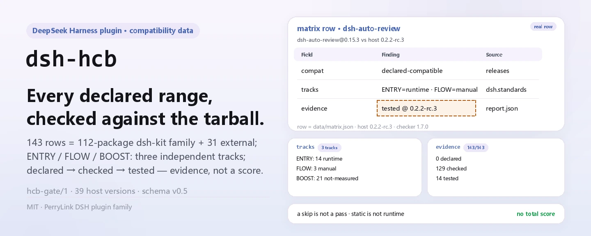
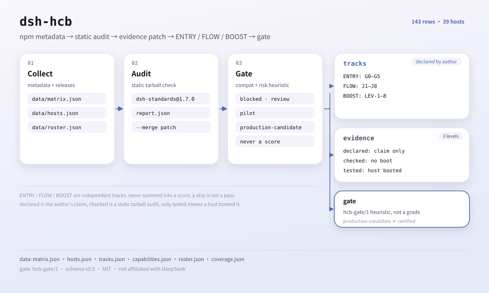

<div align="center">

<picture>
  <source media="(prefers-color-scheme: dark)" srcset="docs/assets/dsh-hcb-hero-en-dark.webp">
  
</picture>

# HCB — Host Compatibility Baseline para plugins de DeepSeek Harness

**Compatibilidad declarada + tracks de adopción declarados, con una capa de evidencia explícita `declared / checked / tested`.**

*No es una puntuación, no es una certificación y no es una garantía de runtime. Proyecto comunitario independiente — sin afiliación con DeepSeek.*

[English](README.md) · [简体中文](README-zh.md) · [Español](README-es.md) · [Português](README-pt.md) · [हिन्दी](README-hi.md)

[](https://github.com/PerryLink/dsh-hcb/actions/workflows/self-check.yml)
[](https://www.npmjs.com/package/dsh-hcb)
[](LICENSE)

</div>

> **HCB es el subproyecto de datos/compuerta de [dsh-standards](https://github.com/PerryLink/dsh-standards).**
> Las reglas, el checker y las definiciones de ENTRY/FLOW/BOOST viven en dsh-standards. Este repositorio mantiene la matriz de compatibilidad, los datos de tracks, la capa de evidencia v0.5, el riesgo y `hcb-gate/1`.
> Proyecto comunitario independiente. **Sin afiliación con DeepSeek.**

**Oficial:** [GitHub (canónico)](https://github.com/PerryLink/dsh-hcb) · [npm](https://www.npmjs.com/package/dsh-hcb) · [espejo Gitee](https://gitee.com/perrylink/dsh-hcb) · [espejo GitCode](https://gitcode.com/PerryLink/dsh-hcb)

```bash
npx dsh-hcb check dsh-auto-review
```

DSH avanza rápido y rompe la compatibilidad a menudo. Los autores de plugins y los compradores enterprise no tienen un único lugar donde responder:

- ¿Qué versiones de DSH *declara* soportar este plugin?
- ¿Declara el estado **DSH-ENTRY / DSH-FLOW / DSH-BOOST** — y con qué evidencia?
- ¿Alguien ha **comprobado** independientemente el tarball publicado, o la fila sigue siendo solo una afirmación?
- ¿Qué superficie de capacidades solicita?
- ¿Está listo para un piloto, o necesita revisión antes?

HCB responde esto a partir de los metadatos del paquete (`engines.dsh`, `peerDependencies`, `dsh.capabilities`, `dsh.standards`), de los releases de DSH en GitHub y — para las filas auditadas — de un informe de checker almacenado.

---

<picture>
  <source media="(prefers-color-scheme: dark)" srcset="docs/assets/dsh-hcb-flow-v5-dark.svg">
  
</picture>

*Estructura: recoger → auditar → compuerta; `data/matrix.json` es la fuente, `row.evidence.checker` etiqueta cada auditoría y declared/checked/tested son los tres niveles de evidencia — un skip no es un pass y static no es runtime. Las etiquetas dentro del diagrama son los nombres reales de archivo, script y track, así que la misma imagen sirve para los cinco idiomas.*

## Tres tracks, no tres niveles

HCB sigue el modelo de [dsh-standards](https://github.com/PerryLink/dsh-standards). **ENTRY / FLOW / BOOST son tracks independientes; nunca se suman en una puntuación.**

| Track | Pregunta | Compuertas | Estados de evidencia |
|---|---|---|---|
| **DSH-ENTRY** | ¿puede reconocerse, instalarse, arrancar? | G0–G5 | runtime / recognized / static / blocked / failed / not-run / stale |
| **DSH-FLOW** | ¿puede un usuario instalarlo, configurarlo, usarlo, recuperarlo, desinstalarlo? | J1–J8 | runtime / manual / not-run / failed / stale |
| **DSH-BOOST** | ¿usa Cordis de forma nativa y eficiente? | LEV-1–8 | measured / not-measured / failed / stale |

Reglas: **un skip no es un pass**; `static` no es `runtime`; **BOOST no es una compuerta**; la compatibilidad es una afirmación del autor del paquete, no un resultado de test. Ver [docs/TRACKS.md](docs/TRACKS.md).

## Qué hay en v0.14.0 (schema v0.5)

| Archivo | Significado |
|---|---|
| `data/hosts.json` | releases de DSH (tag → version → date) |
| `data/matrix.json` | compatibilidad plugin × host **más** tracks `standards`, `evidence`, `risk` y `gate` |
| `data/tracks.json` | recuentos por estado ENTRY/FLOW/BOOST y por decisión de compuerta |
| `data/capabilities.json` | agregación de capacidades / riesgo |
| `spec/tracks.json` | mapeo de consumo de `dsh-levels/1` por parte de HCB |
| `schema/hcb.schema.json` | JSON Schema (v0.5) del formato de datos |
| `data/roster.json` | roster canónico de la familia dsh-kit (112) + externos |
| `data/coverage.json` | cobertura frente al roster |
| `scripts/coverage.mjs` | comprobación de reproducibilidad |
| `scripts/collect.mjs` | colector reproducible; conserva la evidencia checked de la misma versión |
| `scripts/audit-entry.mjs` | **v0.5**: pack + check ENTRY estático -> parche de evidencia (`--merge` opcional) |
| `scripts/migrate-v05.mjs` | migración puntual de matriz v0.4 -> v0.5 |
| `scripts/validate.mjs` | valida la matriz, la evidencia, el resumen y la compuerta |
| `docs/EVIDENCE.md` | contrato de evidencia y guía de re-ejecución |
| `.github/actions/check` | check de CI listo para usar |
| `index.html` | visor estático (GitHub Pages) |

**Niveles de evidencia**:

| Nivel | Producido por | Demuestra |
|---|---|---|
| `declared` | metadatos npm / `package.json#dsh.standards` | solo la afirmación del autor |
| `checked` | `scripts/audit-entry.mjs` -> `dsh-standards@1.7.0 --scope entry --entry-claim static` (por defecto **1.7.0**; las filas históricas se etiquetan con `row.evidence.checker` — las rondas v0.6–v0.8.2 usaron `1.6.10`, salvo `dsh-permission-rules` en v0.8.2) | el tarball publicado se examinó estáticamente; **sin arranque** |
| `tested` | un arranque real de un host DSH (ENTRY G0–G3; harness futuro) | se observó el comportamiento en runtime |

v0.5 entrega la maquinaria de `declared` y `checked`. `tested` está definido pero no lo produce `audit-entry.mjs`; el script es intencionadamente solo estático. Ver [`docs/EVIDENCE.md`](docs/EVIDENCE.md) para el contrato de campos, la semántica de fallo / blocked y los comandos exactos de re-ejecución.

## Cobertura actual (2026-11-15, v0.14.0)

- **143 plugins** = la familia completa de 112 paquetes dsh-kit (34 mainline-default + 53 opt-in + 10 catalog-only + 15 domain) + 31 externos
- **123** declaran `engines.dsh`; **20** son `unknown`
- **21** declaran `dsh.standards`; **122** son `not-declared`
- ENTRY: **14 `runtime` + 127 `recognized` + 2 `failed`** (129 checked + 14 tested), 0 `not-run`, 0 `unknown` — filas runtime: guide, budget, defend, mask, memento, observe, test-drive, checkpoint-rewind, claude-move, data-quality, doublecheck, session-sync, auto-review, permission-rules (todas G0–G3, host 0.2.2-rc.3)
- FLOW: **3 `manual` + 18 `not-run` + 122 `unknown`** — `manual` no es `runtime`; ningún plugin tiene una afirmación FLOW de runtime
- Evidencia: **0 `declared`, 129 `checked`, 14 `tested`**. Las 14 filas tested pasaron un arranque G0–G3 real en el host 0.2.2-rc.3; el resto son `checked` estáticos.
- Checker: **143/143 filas con `dsh-standards@1.7.0`** (0 filas siguen en `1.6.10`). v0.10.2 re-auditó las 95 filas que aún llevaban `1.6.10`; v0.10.3 re-auditó las cuatro filas actualizadas; v0.11.1 re-auditó los 12 refrescos de release. ENTRY ahora es **14 `runtime` + 127 `recognized` + 2 `failed`** y cada fila está etiquetada por `row.evidence.checker`.
- Riesgo: 13 high, 66 medium, 64 unknown (antes 3 / 63 / 77 — las filas refrescadas ya declaran capacidades)
- Compuerta: 2 `blocked` (`dsh-checkers` y `dsh-session-fork`, ambos con ENTRY `failed`), 31 `review`, 108 `pilot`, **2 `production-candidate`** (`dsh-auto-review` y `dsh-plugin-guide`: ENTRY runtime + FLOW manual + riesgo medium). Nueve de las filas refrescadas de alta capacidad pasaron de `pilot` a `review`.

> La adopción casi nula de `dsh.standards` es en sí misma un hallazgo. La compuerta es una **heurística de compatibilidad/riesgo**, no una nota de calidad.

## Cobertura frente al roster canónico (2026-11-15)

HCB se mide contra el roster canónico de la familia `dsh-kit` (112 paquetes), no contra una lista improvisada:

| Grupo | Total | Cubierto por HCB | Checked | Faltan | Tracks declarados | Compatibilidad declarada |
|---|---:|---:|---:|---:|---:|---:|
| mainline-default | 34 | 34 | 34 | 0 | 21 | 34 |
| mainline-opt-in | 53 | 53 | 53 | 0 | 0 | 53 |
| catalog-only | 10 | 10 | 10 | 0 | 0 | 10 |
| domain | 15 | 15 | 15 | 0 | 0 | 15 |
| external | 31 | 31 | 31 | 0 | 0 | 11 |

**112 / 112 paquetes de la familia (100%) están cubiertos y `checked`**, y también **los 31 plugins externos**. La cobertura es completa, pero **la profundidad de evidencia no**: solo 21 plugins declaran tracks y 14 tienen ENTRY runtime. v0.6.0 añadió el pipeline estático `checked` para todo el conjunto mainline-default (34/34); v0.7.0 empezó mainline-opt-in (19/53); v0.8.0 termina las 53 filas opt-in y añade las 2 primeras filas catalog-only (96 checked en total); v0.8.2 refresca tres versiones cambiadas, mantiene `checked` en 96 y re-audita `dsh-permission-rules` con el checker de 16 IDs 1.7.0 (restaurando `recognized`). v0.9.0 audita las últimas 8 filas catalog-only y las 15 domain con `dsh-standards@1.7.0` (23 nuevas; 96 -> 119 checked) y cierra la familia en 112/112 `checked`. **v0.10.0 audita las últimas 24 filas externas `declared` con `dsh-standards@1.7.0` (119 -> 143 checked): 23 `recognized`, 1 `failed` (`dsh-session-fork@0.4.0`, tarball publicado sin su `lib/index.js` declarado).** **v0.10.2 re-audita las 95 filas que aún llevaban `1.6.10` con `dsh-standards@1.7.0` (0 movimientos de ENTRY/compuerta; las 143 filas registran ahora 1.7.0), y 1.7.0 pasa a ser el checker por defecto.** **v0.10.3 absorbe cuatro releases nuevos — `dsh-lsp-actions@0.5.21`, `dsh-doublecheck@0.9.32`, `dsh-memento@0.5.31`, `dsh-session-sync@0.3.2` — re-audita los cuatro con `1.7.0` (todos `recognized`, 13/14 checks, 0 blocking) y registra sus nuevas declaraciones `dsh.standards` (tracks declarados 5 -> 9; reparto de compuerta sin cambios).** **v0.11.1 absorbe 12 releases nuevos — `dsh-research-report@0.4.2`, `dsh-local-ai@0.2.27`, `dsh-industry-research@0.3.26`, `dsh-checkpoint-rewind@0.6.35`, `dsh-defend@0.3.28`, `dsh-claude-move@0.4.20`, `dsh-budget@0.4.26`, `dsh-data-quality@0.3.27`, `dsh-mask@0.2.25`, `dsh-fund-research@0.5.4`, `dsh-observe@0.2.28`, `dsh-test-drive@0.3.26` — re-audita los 12 con `1.7.0` (todos `recognized`, 13/14 checks, 0 blocking), registra 52 entradas de capacidad y 12 declaraciones `dsh.standards` nuevas (tracks declarados 9 -> 21).** El trabajo restante es una matriz `tested` de runtime, no más cobertura estática.

Ejecuta `npm run coverage` para reproducir; la salida derivada de la matriz es la autoritativa (el `data/coverage.json` commiteado es una instantánea histórica).

## CLI


*Animado: la salida real de los scripts incluidos en el repo sobre la matriz commiteada (`node scripts/hcb-cli.mjs check dsh-auto-review`, luego `node scripts/coverage.mjs`; re-ejecutado el 2026-11-21, sin red). Cada número lo leen los scripts de `data/matrix.json`, no está escrito a mano en el README.*

```bash
node scripts/hcb-cli.mjs check dsh-auto-review
node scripts/badge.mjs dsh-auto-review > badge.svg

# auditoría de evidencia v0.5 (dry run por defecto)
node scripts/audit-entry.mjs dsh-plugin-guide
node scripts/audit-entry.mjs dsh-plugin-guide --merge   # revisa antes el parche
npm run validate
npm test
```

## Inicio rápido

```bash
npm install
npm run collect   # necesita GITHUB_TOKEN para límites de tasa mayores
npm run validate
python3 -m http.server 8080   # abre index.html
```

## Uso en CI

```yaml
- uses: PerryLink/dsh-hcb/.github/actions/check@main
  with:
    package: your-npm-package
```

Imprime compatibilidad + tracks + compuerta; por defecto solo falla con `declared-incompatible`. Ver [docs/CI.md](docs/CI.md).

## Cómo añadir un plugin

1. Añade el nombre del paquete npm a `data/plugins.seed.json`.
2. Ejecuta `npm run collect`.
3. Opcional pero recomendado: ejecuta `node scripts/audit-entry.mjs <package>` y,
   tras revisar el parche, `--merge`; commitea el informe crudo en `evidence/`.
4. Abre un PR con los `data/*.json` regenerados, el informe/parche de evidencia y
   el motivo. Una fila checked debe incluir su `reportPath`.

## Qué no es esto

- No es una auditoría de seguridad. Las capacidades declaradas ≠ el comportamiento real.
- No es un test de runtime. `checked` es una comprobación estática del tarball; solo `tested` significa que un host lo arrancó.
- No es un ranking. Sin puntuación total; ENTRY/FLOW/BOOST van separados.
- No es una certificación. `production-candidate` solo significa que HCB no encontró bloqueos en las comprobaciones que conoce.
- No es oficial. No uses el nombre/logo de DeepSeek para implicar respaldo.

## Hoja de ruta

- **v0.4** cobertura completa de la familia de 112 paquetes + tres tracks + riesgo/compuerta.
- **v0.5** capa de evidencia: `declared` / `checked` / `tested`, pipeline de auditoría estática, parches.
- **v0.6** cobertura estática `checked` completa de mainline-default (34/34; 41 checked en total); la matriz de runtime `tested`, el diff de capacidades y las alertas de stale siguen siendo trabajo futuro.
- **v0.7** las primeras 19 de 53 filas mainline-opt-in en `checked` estático (60 checked en total).
- **v0.8** terminar mainline-opt-in (53/53) y añadir las 2 primeras de 10 filas catalog-only en `checked` estático (96 checked en total); las 8 catalog-only restantes, las 15 domain y las 24 external, más el runtime `tested`, siguen siendo trabajo futuro.
- **v0.8.1** refrescar desde npm `dsh-auto-review@0.15.2`, `dsh-permission-rules@0.8.1` y `dsh-plugin-guide@0.5.9`; re-auditar los tres (`checked` sigue en 96); mantener el ENTRY de `dsh-permission-rules` en `blocked` hasta que un checker de 16 IDs valide `sessions:write`; registrar FLOW `manual` para auto-review y permission-rules (nunca `runtime`).
- **v0.9** terminar la familia: 8 catalog-only restantes + 15 filas domain en `checked` estático con `dsh-standards@1.7.0` (23 nuevas; 119 checked en total; 112/112 familia `checked`); las 24 filas externas siguen `declared`, el runtime `tested` sigue siendo trabajo futuro.
- **v0.10** terminar la matriz: las 24 filas externas restantes en `checked` estático con `dsh-standards@1.7.0` (119 -> 143 checked; **0 `declared`**), 23 `recognized` + 1 `failed` (`dsh-session-fork@0.4.0`, falta la entrada compilada). Sin evidencia `tested`; el runtime `tested`, el diff de capacidades y las alertas de stale siguen siendo trabajo futuro.
- **v0.10.2** unificar el checker: re-auditar las 95 filas que siguen en `dsh-standards@1.6.10` con `1.7.0` (143/143 ahora en 1.7.0; ENTRY se mantiene en 141 `recognized` + 2 `failed`), hacer 1.7.0 el valor por defecto y etiquetar las filas históricas con `row.evidence.checker`.
- **v0.10.3** absorber `dsh-lsp-actions@0.5.21`, `dsh-doublecheck@0.9.32`, `dsh-memento@0.5.31` y `dsh-session-sync@0.3.2`: cuatro re-auditorías con `1.7.0`, todos `recognized` (13/14, 0 blocking); tracks declarados 5 -> 9; ENTRY/compuerta sin cambios (141 `recognized` + 2 `failed`; 2 blocked / 21 review / 120 pilot).
- **v0.11.1** absorber 12 releases nuevos (`dsh-research-report@0.4.2` hasta `dsh-test-drive@0.3.26`): 12 re-auditorías con `1.7.0`, todos `recognized` (13/14, 0 blocking), 52 entradas de capacidad, tracks declarados 9 -> 21; nueve filas de alta capacidad pasan de `pilot` a `review`, así que la compuerta es 2 blocked / 30 review / 110 pilot / 1 production-candidate. `dsh-mcp-panel` (0.6.32 sin publicar) y `dsh-click` (0.3.29; 0.3.30 estaba en staging al fijar el alcance) se quedan en sus versiones antiguas.
- **v1.0** schema estable + action de CI + refresco semanal + DOI.

## Licencia

MIT (código y datos). Ver `LICENSE`. El modelo de tracks es Apache-2.0 de dsh-standards; ver `NOTICE.md`.
