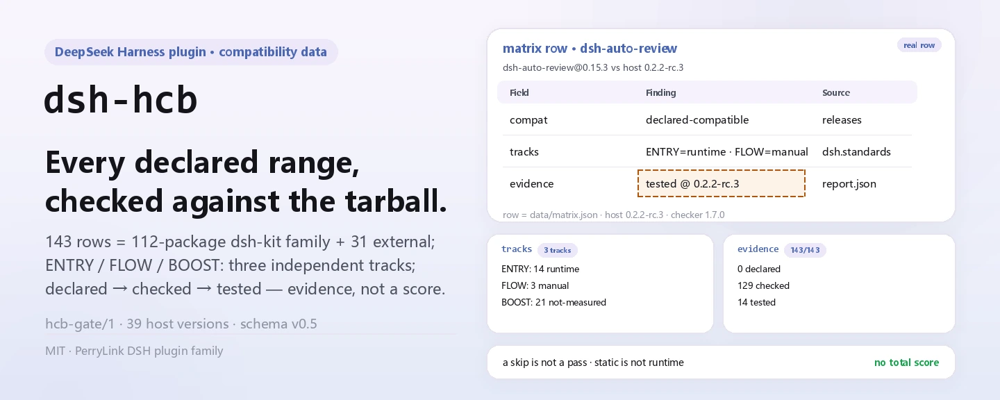
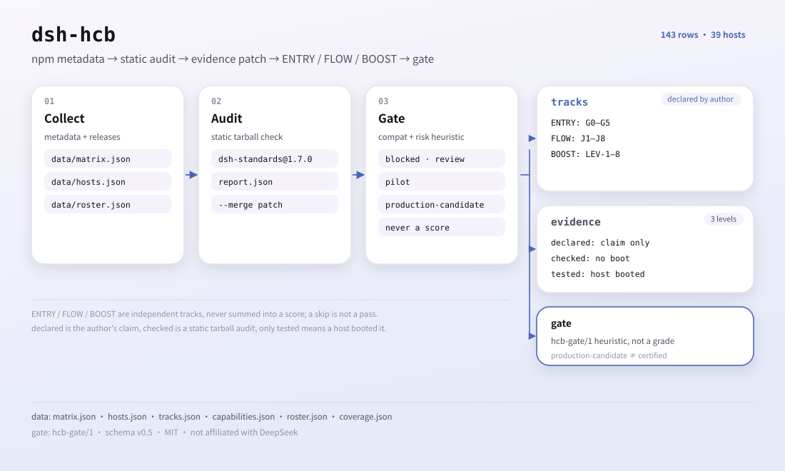
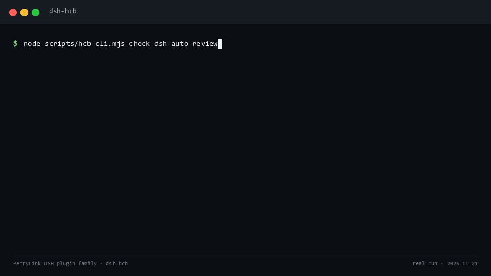

<div align="center">

<picture>
  <source media="(prefers-color-scheme: dark)" srcset="docs/assets/dsh-hcb-hero-en-dark.webp">
  
</picture>

# HCB — DeepSeek Harness प्लगइन्स के लिए होस्ट कम्पैटिबिलिटी बेसलाइन

**घोषित कम्पैटिबिलिटी + घोषित अपनाव ट्रैक, साथ में स्पष्ट `declared / checked / tested` एविडेंस परत।**

*यह कोई स्कोर नहीं, कोई प्रमाणन नहीं, और रनटाइम की कोई गारंटी नहीं है। स्वतंत्र कम्युनिटी प्रोजेक्ट — DeepSeek से किसी तरह जुड़ा नहीं।*

[English](README.md) · [简体中文](README-zh.md) · [Español](README-es.md) · [Português](README-pt.md) · [हिन्दी](README-hi.md)

[](https://github.com/PerryLink/dsh-hcb/actions/workflows/self-check.yml)
[](https://www.npmjs.com/package/dsh-hcb)
[](LICENSE)

</div>

> **HCB, [dsh-standards](https://github.com/PerryLink/dsh-standards) का डेटा/गेट उपप्रोजेक्ट है।**
> नियम, चेकर और ENTRY/FLOW/BOOST की परिभाषाएँ dsh-standards में रहती हैं। यह रिपॉज़िटरी कम्पैटिबिलिटी मैट्रिक्स, tracks डेटा, v0.5 एविडेंस परत, जोखिम और `hcb-gate/1` रखती है।
> स्वतंत्र कम्युनिटी प्रोजेक्ट। **DeepSeek से किसी तरह जुड़ा नहीं।**

**आधिकारिक:** [GitHub (मुख्य)](https://github.com/PerryLink/dsh-hcb) · [npm](https://www.npmjs.com/package/dsh-hcb) · [Gitee मिरर](https://gitee.com/perrylink/dsh-hcb) · [GitCode मिरर](https://gitcode.com/PerryLink/dsh-hcb)

```bash
npx dsh-hcb check dsh-auto-review
```

DSH तेज़ी से आगे बढ़ता है और कम्पैटिबिलिटी अक्सर तोड़ देता है। प्लगइन लेखकों और एंटरप्राइज़ खरीदारों के पास यह जानने की एक जगह नहीं है:

- यह प्लगइन किन DSH वर्ज़नों का समर्थन *घोषित* करता है?
- क्या यह **DSH-ENTRY / DSH-FLOW / DSH-BOOST** स्थिति घोषित करता है — और किस एविडेंस के साथ?
- क्या किसी ने प्रकाशित tarball को स्वतंत्र रूप से **जाँचा** है, या पंक्ति अभी भी केवल दावा है?
- यह कितनी क्षमताओं का अनुरोध करता है?
- यह पायलट के लिए तैयार है, या पहले समीक्षा चाहिए?

HCB इनका उत्तर पैकेज मेटाडेटा (`engines.dsh`, `peerDependencies`, `dsh.capabilities`, `dsh.standards`), DSH GitHub releases, और — ऑडिट की गई पंक्तियों के लिए — संग्रहीत चेकर रिपोर्ट से देता है।

---

<picture>
  <source media="(prefers-color-scheme: dark)" srcset="docs/assets/dsh-hcb-flow-v5-dark.svg">
  
</picture>

*संरचना: एकत्र → ऑडिट → गेट; `data/matrix.json` स्रोत है, `row.evidence.checker` हर ऑडिट को लेबल करता है, और declared/checked/tested तीन एविडेंस स्तर हैं — skip, pass नहीं है और static, runtime नहीं है। डायग्राम के अंदर के लेबल असली फ़ाइल, स्क्रिप्ट और track नाम हैं, इसलिए एक ही चित्र पाँचों भाषाओं के लिए काम आता है।*

## तीन tracks, तीन स्तर नहीं

HCB [dsh-standards](https://github.com/PerryLink/dsh-standards) का मॉडल अपनाता है। **ENTRY / FLOW / BOOST स्वतंत्र tracks हैं; उन्हें कभी जोड़कर स्कोर नहीं बनाया जाता।**

| Track | प्रश्न | गेट | एविडेंस अवस्थाएँ |
|---|---|---|---|
| **DSH-ENTRY** | क्या इसे पहचाना, इंस्टॉल और बूट किया जा सकता है? | G0–G5 | runtime / recognized / static / blocked / failed / not-run / stale |
| **DSH-FLOW** | क्या उपयोगकर्ता इसे इंस्टॉल, कॉन्फ़िगर, इस्तेमाल, रिकवर, अनइंस्टॉल कर सकता है? | J1–J8 | runtime / manual / not-run / failed / stale |
| **DSH-BOOST** | क्या यह Cordis का मूल और कुशल उपयोग करता है? | LEV-1–8 | measured / not-measured / failed / stale |

नियम: **skip, pass नहीं है**; `static` `runtime` नहीं है; **BOOST कोई गेट नहीं है**; कम्पैटिबिलिटी पैकेज लेखक का दावा है, परीक्षण परिणाम नहीं। देखें [docs/TRACKS.md](docs/TRACKS.md)।

## v0.14.0 (schema v0.5) में क्या है

| फ़ाइल | अर्थ |
|---|---|
| `data/hosts.json` | DSH releases (tag → version → date) |
| `data/matrix.json` | plugin × host कम्पैटिबिलिटी **और** `standards` tracks, `evidence`, `risk`, `gate` |
| `data/tracks.json` | प्रत्येक ENTRY/FLOW/BOOST अवस्था और gate निर्णय की गणना |
| `data/capabilities.json` | क्षमता / जोखिम एकत्रीकरण |
| `spec/tracks.json` | `dsh-levels/1` का HCB उपभोक्ता मैपिंग |
| `schema/hcb.schema.json` | डेटा प्रारूप का JSON Schema (v0.5) |
| `data/roster.json` | मानक dsh-kit परिवार roster (112) + बाहरी |
| `data/coverage.json` | roster के मुकाबले कवरेज |
| `scripts/coverage.mjs` | पुनरुत्पादन जाँच |
| `scripts/collect.mjs` | पुनरुत्पाद्य कलेक्टर; एक ही संस्करण के checked एविडेंस सुरक्षित रखता है |
| `scripts/audit-entry.mjs` | **v0.5**: pack + स्थिर ENTRY जाँच -> एविडेंस पैच (वैकल्पिक `--merge`) |
| `scripts/migrate-v05.mjs` | एक बार का v0.4 -> v0.5 मैट्रिक्स माइग्रेशन |
| `scripts/validate.mjs` | मैट्रिक्स, एविडेंस, सारांश और gate को मान्य करता है |
| `docs/EVIDENCE.md` | एविडेंस अनुबंध और दोबारा चलाने की गाइड |
| `.github/actions/check` | सीधे इस्तेमाल करने योग्य CI जाँच |
| `index.html` | स्थिर व्यूअर (GitHub Pages) |

**एविडेंस स्तर**:

| स्तर | किसने बनाया | क्या साबित करता है |
|---|---|---|
| `declared` | npm मेटाडेटा / `package.json#dsh.standards` | केवल लेखक का दावा |
| `checked` | `scripts/audit-entry.mjs` -> `dsh-standards@1.7.0 --scope entry --entry-claim static` (डिफ़ॉल्ट **1.7.0**; ऐतिहासिक पंक्तियाँ `row.evidence.checker` से लेबल होती हैं — v0.6–v0.8.2 दौर में `1.6.10` इस्तेमाल हुआ, सिवाय v0.8.2 में `dsh-permission-rules` के) | प्रकाशित tarball की स्थिर जाँच हुई; **कोई बूट नहीं** |
| `tested` | असली DSH होस्ट बूट (ENTRY G0–G3; भविष्य का harness) | रनटाइम व्यवहार देखा गया |

v0.5 `declared` और `checked` मशीनरी देता है। `tested` परिभाषित है, लेकिन `audit-entry.mjs` उसे नहीं बनाता; वह स्क्रिप्ट जानबूझकर केवल-स्थिर है। फ़ील्ड अनुबंध, विफलता / blocked अर्थशास्त्र और दोबारा चलाने के सटीक कमांड के लिए देखें [`docs/EVIDENCE.md`](docs/EVIDENCE.md)।

## वर्तमान कवरेज (2026-11-15, v0.14.0)

- **143 प्लगइन** = पूरा 112-पैकेज dsh-kit परिवार (34 mainline-default + 53 opt-in + 10 catalog-only + 15 domain) + 31 बाहरी
- **123** `engines.dsh` घोषित करते हैं; **20** `unknown` हैं
- **21** `dsh.standards` घोषित करते हैं; **122** `not-declared` हैं
- ENTRY: **14 `runtime` + 127 `recognized` + 2 `failed`** (129 checked + 14 tested), 0 `not-run`, 0 `unknown` — runtime पंक्तियाँ: guide, budget, defend, mask, memento, observe, test-drive, checkpoint-rewind, claude-move, data-quality, doublecheck, session-sync, auto-review, permission-rules (सभी G0–G3, host 0.2.2-rc.3)
- FLOW: **3 `manual` + 18 `not-run` + 122 `unknown`** — `manual` `runtime` नहीं है; किसी प्लगइन का रनटाइम FLOW दावा नहीं है
- एविडेंस: **0 `declared`, 129 `checked`, 14 `tested`**। 14 tested पंक्तियों ने host 0.2.2-rc.3 पर असली G0–G3 बूट पास किया; बाकी स्थिर `checked` हैं।
- चेकर: **143/143 पंक्तियाँ `dsh-standards@1.7.0` पर** (0 पंक्तियाँ अब भी `1.6.10` पर)। v0.10.2 ने उन 95 पंक्तियों को फिर ऑडिट किया जो अब भी `1.6.10` रखती थीं; v0.10.3 ने चार अपडेट हुई पंक्तियों को फिर ऑडिट किया; v0.11.1 ने 12 release रीफ़्रेश फिर ऑडिट किए। ENTRY अपरिवर्तित है (**1 `runtime` + 140 `recognized` + 2 `failed`) और हर पंक्ति `row.evidence.checker` से लेबल है।
- जोखिम: 12 high, 66 medium, 65 unknown (पहले 3 / 63 / 77 — अब 12 रीफ़्रेश पंक्तियाँ क्षमताएँ घोषित करती हैं)
- गेट: 2 `blocked` (`dsh-checkers` और `dsh-session-fork`, दोनों का ENTRY `failed`), 30 `review`, 110 `pilot`, **1 `production-candidate`** (`dsh-plugin-guide`: ENTRY runtime + FLOW manual + जोखिम medium)। रीफ़्रेश हुई उच्च-क्षमता पंक्तियों में से नौ `pilot` से `review` पर गईं।

> लगभग शून्य `dsh.standards` अपनाव अपने आप में एक निष्कर्ष है। गेट एक **कम्पैटिबिलिटी/जोखिम ह्यूरिस्टिक** है, गुणवत्ता ग्रेड नहीं।

## मानक roster के मुकाबले कवरेज (2026-11-15)

HCB को मानक `dsh-kit` परिवार roster (112 पैकेज) के मुकाबले मापा जाता है, किसी तदर्थ सूची के मुकाबले नहीं:

| समूह | कुल | HCB से कवर | Checked | गायब | घोषित tracks | घोषित compat |
|---|---:|---:|---:|---:|---:|---:|
| mainline-default | 34 | 34 | 34 | 0 | 21 | 34 |
| mainline-opt-in | 53 | 53 | 53 | 0 | 0 | 53 |
| catalog-only | 10 | 10 | 10 | 0 | 0 | 10 |
| domain | 15 | 15 | 15 | 0 | 0 | 15 |
| external | 31 | 31 | 31 | 0 | 0 | 11 |

**112 / 112 परिवार पैकेज (100%) कवर और `checked` हैं**, और **सभी 31 बाहरी प्लगइन** भी। कवरेज पूरा है, पर **एविडेंस की गहराई नहीं**: केवल 21 प्लगइन tracks घोषित करते हैं, और 1 का ENTRY runtime है। v0.6.0 ने पूरे mainline-default सेट के लिए स्थिर `checked` पाइपलाइन जोड़ी (34/34); v0.7.0 ने mainline-opt-in शुरू किया (19/53); v0.8.0 ने सभी 53 opt-in पंक्तियाँ पूरी कीं और पहली 2 catalog-only पंक्तियाँ जोड़ीं (कुल 96 checked); v0.8.2 ने तीन बदली पैकेज संस्करणों को रीफ़्रेश किया, `checked` को 96 पर रखा, और 16-ID चेकर 1.7.0 के साथ `dsh-permission-rules` को फिर ऑडिट किया (`recognized` बहाल)। v0.9.0 ने आख़िरी 8 catalog-only और सभी 15 domain पंक्तियों को `dsh-standards@1.7.0` से ऑडिट किया (23 नई; 96 -> 119 checked) और परिवार को 112/112 `checked` पर बंद किया। **v0.10.0 ने आख़िरी 24 बाहरी `declared` पंक्तियों को `dsh-standards@1.7.0` से ऑडिट किया (119 -> 143 checked): 23 `recognized`, 1 `failed` (`dsh-session-fork@0.4.0`, प्रकाशित tarball में उसका घोषित `lib/index.js` नहीं है)।** **v0.10.2 ने उन 95 पंक्तियों को `dsh-standards@1.7.0` से फिर ऑडिट किया जो अब भी `1.6.10` पर थीं (0 ENTRY/gate बदलाव; 143 पंक्तियाँ अब 1.7.0 दर्ज करती हैं), और 1.7.0 डिफ़ॉल्ट चेकर बना।** **v0.10.3 ने चार नए release अपनाए — `dsh-lsp-actions@0.5.21`, `dsh-doublecheck@0.9.32`, `dsh-memento@0.5.31`, `dsh-session-sync@0.3.2` — चारों को `1.7.0` से फिर ऑडिट किया (सभी `recognized`, 13/14 जाँचें, 0 blocking) और उनकी नई `dsh.standards` घोषणाएँ दर्ज कीं (घोषित tracks 5 -> 9; gate विभाजन अपरिवर्तित)।** **v0.11.1 ने 12 नए release अपनाए — `dsh-research-report@0.4.2`, `dsh-local-ai@0.2.27`, `dsh-industry-research@0.3.26`, `dsh-checkpoint-rewind@0.6.35`, `dsh-defend@0.3.28`, `dsh-claude-move@0.4.20`, `dsh-budget@0.4.26`, `dsh-data-quality@0.3.27`, `dsh-mask@0.2.25`, `dsh-fund-research@0.5.4`, `dsh-observe@0.2.28`, `dsh-test-drive@0.3.26` — बारहों को `1.7.0` से फिर ऑडिट किया (सभी `recognized`, 13/14 जाँचें, 0 blocking), 52 नई क्षमता प्रविष्टियाँ और 12 नई `dsh.standards` घोषणाएँ दर्ज कीं (घोषित tracks 9 -> 21)।** बचा काम रनटाइम `tested` मैट्रिक्स है, और स्थिर कवरेज नहीं।

पुनरुत्पादन के लिए `npm run coverage` चलाएँ; मैट्रिक्स से निकला आउटपुट ही आधिकारिक है (कमिट किया गया `data/coverage.json` ऐतिहासिक स्नैपशॉट है)।

## CLI



*एनिमेटेड: कमिट की गई मैट्रिक्स पर रिपॉज़िटरी के स्क्रिप्ट्स का असली आउटपुट (`node scripts/hcb-cli.mjs check dsh-auto-review`, फिर `node scripts/coverage.mjs`; 2026-11-21 को दोबारा चलाया गया, बिना नेटवर्क)। हर संख्या स्क्रिप्ट्स द्वारा `data/matrix.json` से पढ़ी जाती है, README में हाथ से नहीं लिखी जाती।*

```bash
node scripts/hcb-cli.mjs check dsh-auto-review
node scripts/badge.mjs dsh-auto-review > badge.svg

# v0.5 एविडेंस ऑडिट (डिफ़ॉल्ट dry run)
node scripts/audit-entry.mjs dsh-plugin-guide
node scripts/audit-entry.mjs dsh-plugin-guide --merge   # पहले पैच की समीक्षा करें
npm run validate
npm test
```

## क्विक स्टार्ट

```bash
npm install
npm run collect   # ऊँची दर सीमा के लिए GITHUB_TOKEN चाहिए
npm run validate
python3 -m http.server 8080   # index.html खोलें
```

## CI में उपयोग

```yaml
- uses: PerryLink/dsh-hcb/.github/actions/check@main
  with:
    package: your-npm-package
```

यह कम्पैटिबिलिटी + tracks + gate छापता है; डिफ़ॉल्ट में केवल `declared-incompatible` पर फ़ेल होता है। देखें [docs/CI.md](docs/CI.md)।

## प्लगइन कैसे जोड़ें

1. npm पैकेज का नाम `data/plugins.seed.json` में जोड़ें।
2. `npm run collect` चलाएँ।
3. वैकल्पिक पर सलाहित: `node scripts/audit-entry.mjs <package>` चलाएँ और,
   पैच की समीक्षा के बाद, `--merge` करें; कच्ची रिपोर्ट `evidence/` में कमिट करें।
4. पुनः उत्पन्न `data/*.json`, एविडेंस रिपोर्ट/पैच और कारण के साथ PR खोलें।
   checked पंक्ति में उसका `reportPath` शामिल होना चाहिए।

## यह क्या नहीं है

- सुरक्षा ऑडिट नहीं। घोषित क्षमताएँ ≠ असली व्यवहार।
- रनटाइम परीक्षण नहीं। `checked` स्थिर tarball जाँच है; केवल `tested` का अर्थ है कि किसी होस्ट ने इसे बूट किया।
- रैंकिंग नहीं। कोई कुल स्कोर नहीं; ENTRY/FLOW/BOOST अलग हैं।
- प्रमाणन नहीं। `production-candidate` का अर्थ केवल यह है कि HCB को अपनी ज्ञात जाँचों में कोई ब्लॉकर नहीं मिला।
- आधिकारिक नहीं। समर्थन का संकेत देने के लिए DeepSeek का नाम/लोगो न इस्तेमाल करें।

## रोडमैप

- **v0.4** पूरा 112-पैकेज परिवार कवरेज + तीन tracks + जोखिम/गेट।
- **v0.5** एविडेंस परत: `declared` / `checked` / `tested`, स्थिर ऑडिट पाइपलाइन, पैच।
- **v0.6** mainline-default का पूरा स्थिर `checked` कवरेज (34/34; कुल 41 checked); रनटाइम `tested` मैट्रिक्स, क्षमता diff और stale अलर्ट भविष्य का काम हैं।
- **v0.7** 53 mainline-opt-in पंक्तियों में से पहली 19 स्थिर `checked` (कुल 60 checked)।
- **v0.8** mainline-opt-in पूरा (53/53) और 10 catalog-only में से पहली 2 पंक्तियाँ स्थिर `checked` (कुल 96 checked); बची 8 catalog-only, 15 domain और 24 external पंक्तियाँ तथा रनटाइम `tested` भविष्य का काम हैं।
- **v0.8.1** npm से `dsh-auto-review@0.15.2`, `dsh-permission-rules@0.8.1` और `dsh-plugin-guide@0.5.9` रीफ़्रेश करें; तीनों को फिर ऑडिट करें (`checked` 96 पर रहता है); `dsh-permission-rules` का ENTRY `blocked` तब तक रखें जब तक 16-ID चेकर `sessions:write` को मान्य न कर सके; auto-review और permission-rules के लिए FLOW `manual` दर्ज करें (कभी `runtime` नहीं)।
- **v0.9** परिवार समाप्त करें: बची 8 catalog-only + 15 domain पंक्तियाँ `dsh-standards@1.7.0` से स्थिर `checked` (23 नई; कुल 119 checked; 112/112 परिवार `checked`); 24 बाहरी पंक्तियाँ `declared` रहती हैं, रनटाइम `tested` भविष्य का काम है।
- **v0.10** मैट्रिक्स समाप्त करें: बची सभी 24 बाहरी पंक्तियाँ `dsh-standards@1.7.0` से स्थिर `checked` (119 -> 143 checked; **0 `declared`**), 23 `recognized` + 1 `failed` (`dsh-session-fork@0.4.0`, बिल्ट एंट्री गायब)। कोई `tested` एविडेंस नहीं; रनटाइम `tested`, क्षमता diff और stale अलर्ट भविष्य का काम हैं।
- **v0.10.2** चेकर एकीकृत करें: अब भी `dsh-standards@1.6.10` पर रहने वाली 95 पंक्तियों को `1.7.0` से फिर ऑडिट करें (143/143 अब 1.7.0; ENTRY 141 `recognized` + 2 `failed` पर रहता है), 1.7.0 को डिफ़ॉल्ट बनाएँ, और ऐतिहासिक पंक्तियों को `row.evidence.checker` से लेबल करें।
- **v0.10.3** `dsh-lsp-actions@0.5.21`, `dsh-doublecheck@0.9.32`, `dsh-memento@0.5.31` और `dsh-session-sync@0.3.2` अपनाएँ: चार `1.7.0` पुनर्-ऑडिट, सभी `recognized` (13/14, 0 blocking); घोषित tracks 5 -> 9; ENTRY/gate अपरिवर्तित (141 `recognized` + 2 `failed`; 2 blocked / 21 review / 120 pilot)।
- **v0.11.1** 12 नए release अपनाएँ (`dsh-research-report@0.4.2` से `dsh-test-drive@0.3.26` तक): 12 `1.7.0` पुनर्-ऑडिट, सभी `recognized` (13/14, 0 blocking), 52 क्षमता प्रविष्टियाँ, घोषित tracks 9 -> 21; नौ उच्च-क्षमता पंक्तियाँ `pilot` से `review` पर जाती हैं, इसलिए gate 2 blocked / 30 review / 110 pilot / 1 production-candidate है। `dsh-mcp-panel` (0.6.32 प्रकाशित नहीं) और `dsh-click` (0.3.29; दायरा तय करते समय 0.3.30 staging में था) अपने पुराने संस्करणों पर रहते हैं।
- **v1.0** स्थिर schema + CI action + साप्ताहिक रीफ़्रेश + DOI।

## लाइसेंस

MIT (कोड और डेटा)। देखें `LICENSE`। track मॉडल dsh-standards से Apache-2.0 है; देखें `NOTICE.md`।
