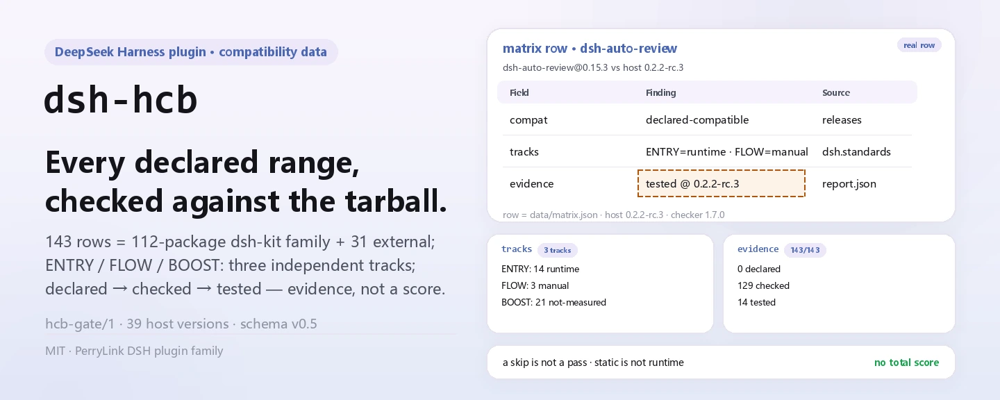
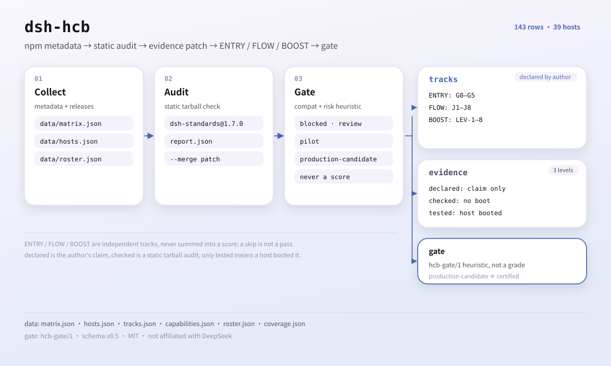

<div align="center">

<picture>
  <source media="(prefers-color-scheme: dark)" srcset="docs/assets/dsh-hcb-hero-en-dark.webp">
  
</picture>

# HCB — Host Compatibility Baseline para plugins do DeepSeek Harness

**Compatibilidade declarada + tracks de adoção declarados, com uma camada explícita de evidência `declared / checked / tested`.**

*Não é uma pontuação, não é uma certificação e não é uma garantia de runtime. Projeto comunitário independente — sem afiliação com a DeepSeek.*

[English](README.md) · [简体中文](README-zh.md) · [Español](README-es.md) · [Português](README-pt.md) · [हिन्दी](README-hi.md)

[](https://github.com/PerryLink/dsh-hcb/actions/workflows/self-check.yml)
[](https://www.npmjs.com/package/dsh-hcb)
[](LICENSE)

</div>

> **O HCB é o subprojeto de dados/gate do [dsh-standards](https://github.com/PerryLink/dsh-standards).**
> As regras, o checker e as definições de ENTRY/FLOW/BOOST vivem no dsh-standards. Este repositório mantém a matriz de compatibilidade, os dados de tracks, a camada de evidência v0.5, o risco e o `hcb-gate/1`.
> Projeto comunitário independente. **Sem afiliação com a DeepSeek.**

**Oficial:** [GitHub (canônico)](https://github.com/PerryLink/dsh-hcb) · [npm](https://www.npmjs.com/package/dsh-hcb) · [espelho Gitee](https://gitee.com/perrylink/dsh-hcb) · [espelho GitCode](https://gitcode.com/PerryLink/dsh-hcb)

```bash
npx dsh-hcb check dsh-auto-review
```

O DSH avança rápido e quebra compatibilidade com frequência. Autores de plugins e compradores enterprise não têm um único lugar para responder:

- Quais versões do DSH este plugin *declara* suportar?
- Ele declara o status **DSH-ENTRY / DSH-FLOW / DSH-BOOST** — e com qual evidência?
- Alguém já **checou** o tarball publicado de forma independente, ou a linha ainda é só uma afirmação?
- Que superfície de capacidades ele pede?
- Está pronto para piloto, ou precisa de revisão antes?

O HCB responde isso a partir dos metadados do pacote (`engines.dsh`, `peerDependencies`, `dsh.capabilities`, `dsh.standards`), dos releases do DSH no GitHub e — para linhas já auditadas — de um relatório de checker armazenado.

---

<picture>
  <source media="(prefers-color-scheme: dark)" srcset="docs/assets/dsh-hcb-flow-v5-dark.svg">
  
</picture>

*Estrutura: coletar → auditar → gate; `data/matrix.json` é a fonte, `row.evidence.checker` rotula cada auditoria e declared/checked/tested são os três níveis de evidência — um skip não é um pass e static não é runtime. Os rótulos dentro do diagrama são os nomes reais de arquivo, script e track, então a mesma imagem serve aos cinco idiomas.*

## Três tracks, não três níveis

O HCB segue o modelo do [dsh-standards](https://github.com/PerryLink/dsh-standards). **ENTRY / FLOW / BOOST são tracks independentes; nunca são somados numa pontuação.**

| Track | Pergunta | Gates | Estados de evidência |
|---|---|---|---|
| **DSH-ENTRY** | pode ser reconhecido, instalado, iniciado? | G0–G5 | runtime / recognized / static / blocked / failed / not-run / stale |
| **DSH-FLOW** | um usuário consegue instalar, configurar, usar, recuperar, desinstalar? | J1–J8 | runtime / manual / not-run / failed / stale |
| **DSH-BOOST** | usa o Cordis de forma nativa e eficiente? | LEV-1–8 | measured / not-measured / failed / stale |

Regras: **um skip não é um pass**; `static` não é `runtime`; **BOOST não é um gate**; compatibilidade é uma afirmação do autor do pacote, não um resultado de teste. Veja [docs/TRACKS.md](docs/TRACKS.md).

## O que há na v0.14.0 (schema v0.5)

| Arquivo | Significado |
|---|---|
| `data/hosts.json` | releases do DSH (tag → version → date) |
| `data/matrix.json` | compatibilidade plugin × host **mais** tracks `standards`, `evidence`, `risk` e `gate` |
| `data/tracks.json` | contagens por estado ENTRY/FLOW/BOOST e por decisão de gate |
| `data/capabilities.json` | agregação de capacidades / risco |
| `spec/tracks.json` | mapeamento de consumo do `dsh-levels/1` pelo HCB |
| `schema/hcb.schema.json` | JSON Schema (v0.5) do formato de dados |
| `data/roster.json` | roster canônico da família dsh-kit (112) + externos |
| `data/coverage.json` | cobertura frente ao roster |
| `scripts/coverage.mjs` | checagem de reprodutibilidade |
| `scripts/collect.mjs` | coletor reproduzível; preserva evidência checked da mesma versão |
| `scripts/audit-entry.mjs` | **v0.5**: pack + checagem ENTRY estática -> patch de evidência (`--merge` opcional) |
| `scripts/migrate-v05.mjs` | migração única de matriz v0.4 -> v0.5 |
| `scripts/validate.mjs` | valida a matriz, a evidência, o resumo e o gate |
| `docs/EVIDENCE.md` | contrato de evidência e guia de re-execução |
| `.github/actions/check` | check de CI pronto para usar |
| `index.html` | visualizador estático (GitHub Pages) |

**Níveis de evidência**:

| Nível | Produzido por | Prova |
|---|---|---|
| `declared` | metadados npm / `package.json#dsh.standards` | apenas a afirmação do autor |
| `checked` | `scripts/audit-entry.mjs` -> `dsh-standards@1.7.0 --scope entry --entry-claim static` (padrão **1.7.0**; linhas históricas são rotuladas por `row.evidence.checker` — as rodadas v0.6–v0.8.2 usaram `1.6.10`, exceto `dsh-permission-rules` na v0.8.2) | o tarball publicado foi examinado estaticamente; **sem boot** |
| `tested` | um boot real de host DSH (ENTRY G0–G3; harness futuro) | o comportamento em runtime foi observado |

A v0.5 entrega a maquinaria de `declared` e `checked`. `tested` está definido, mas não é produzido pelo `audit-entry.mjs`; o script é intencionalmente só estático. Veja [`docs/EVIDENCE.md`](docs/EVIDENCE.md) para o contrato de campos, a semântica de falha / blocked e os comandos exatos de re-execução.

## Cobertura atual (2026-11-15, v0.14.0)

- **143 plugins** = a família completa de 112 pacotes dsh-kit (34 mainline-default + 53 opt-in + 10 catalog-only + 15 domain) + 31 externos
- **123** declaram `engines.dsh`; **20** são `unknown`
- **21** declaram `dsh.standards`; **122** são `not-declared`
- ENTRY: **14 `runtime` + 127 `recognized` + 2 `failed`** (129 checked + 14 tested), 0 `not-run`, 0 `unknown` — linhas runtime: guide, budget, defend, mask, memento, observe, test-drive, checkpoint-rewind, claude-move, data-quality, doublecheck, session-sync, auto-review, permission-rules (todas G0–G3, host 0.2.2-rc.3)
- FLOW: **3 `manual` + 18 `not-run` + 122 `unknown`** — `manual` não é `runtime`; nenhum plugin tem afirmação FLOW de runtime
- Evidência: **0 `declared`, 129 `checked`, 14 `tested`**. As 14 linhas tested passaram por um boot G0–G3 real no host 0.2.2-rc.3; as demais são `checked` estáticas.
- Checker: **143/143 linhas em `dsh-standards@1.7.0`** (0 linhas ainda em `1.6.10`). A v0.10.2 re-auditou as 95 linhas que ainda traziam `1.6.10`; a v0.10.3 re-auditou as quatro linhas atualizadas; a v0.11.1 re-auditou os 12 refreshes de release. ENTRY não muda (**1 `runtime` + 140 `recognized` + 2 `failed`) e cada linha é rotulada por `row.evidence.checker`.
- Risco: 12 high, 66 medium, 65 unknown (antes 3 / 63 / 77 — as 12 linhas refrescadas agora declaram capacidades)
- Gate: 2 `blocked` (`dsh-checkers` e `dsh-session-fork`, ambos com ENTRY `failed`), 30 `review`, 110 `pilot`, **1 `production-candidate`** (`dsh-plugin-guide`: ENTRY runtime + FLOW manual + risco medium). Nove das linhas refrescadas de alta capacidade passaram de `pilot` para `review`.

> A adoção quase nula de `dsh.standards` é ela própria um achado. O gate é uma **heurística de compatibilidade/risco**, não uma nota de qualidade.

## Cobertura frente ao roster canônico (2026-11-15)

O HCB é medido contra o roster canônico da família `dsh-kit` (112 pacotes), não contra uma lista improvisada:

| Grupo | Total | Coberto pelo HCB | Checked | Faltando | Tracks declarados | Compatibilidade declarada |
|---|---:|---:|---:|---:|---:|---:|
| mainline-default | 34 | 34 | 34 | 0 | 21 | 34 |
| mainline-opt-in | 53 | 53 | 53 | 0 | 0 | 53 |
| catalog-only | 10 | 10 | 10 | 0 | 0 | 10 |
| domain | 15 | 15 | 15 | 0 | 0 | 15 |
| external | 31 | 31 | 31 | 0 | 0 | 11 |

**112 / 112 pacotes da família (100%) estão cobertos e `checked`**, e também **todos os 31 plugins externos**. A cobertura é completa, mas **a profundidade de evidência não**: só 21 plugins declaram tracks e 1 tem ENTRY runtime. A v0.6.0 adicionou o pipeline estático `checked` para todo o conjunto mainline-default (34/34); a v0.7.0 começou o mainline-opt-in (19/53); a v0.8.0 termina as 53 linhas opt-in e adiciona as 2 primeiras linhas catalog-only (96 checked no total); a v0.8.2 refresca três versões alteradas, mantém `checked` em 96 e re-audita `dsh-permission-rules` com o checker de 16 IDs 1.7.0 (restaurando `recognized`). A v0.9.0 audita as últimas 8 linhas catalog-only e as 15 domain com `dsh-standards@1.7.0` (23 novas; 96 -> 119 checked) e fecha a família em 112/112 `checked`. **A v0.10.0 audita as últimas 24 linhas externas `declared` com `dsh-standards@1.7.0` (119 -> 143 checked): 23 `recognized`, 1 `failed` (`dsh-session-fork@0.4.0`, tarball publicado sem o `lib/index.js` declarado).** **A v0.10.2 re-audita as 95 linhas que ainda traziam `1.6.10` com `dsh-standards@1.7.0` (0 mudanças de ENTRY/gate; as 143 linhas agora registram 1.7.0), e 1.7.0 passa a ser o checker padrão.** **A v0.10.3 absorve quatro releases novos — `dsh-lsp-actions@0.5.21`, `dsh-doublecheck@0.9.32`, `dsh-memento@0.5.31`, `dsh-session-sync@0.3.2` — re-audita os quatro com `1.7.0` (todos `recognized`, 13/14 checks, 0 blocking) e registra suas novas declarações `dsh.standards` (tracks declarados 5 -> 9; divisão do gate sem mudanças).** **A v0.11.1 absorve 12 releases novos — `dsh-research-report@0.4.2`, `dsh-local-ai@0.2.27`, `dsh-industry-research@0.3.26`, `dsh-checkpoint-rewind@0.6.35`, `dsh-defend@0.3.28`, `dsh-claude-move@0.4.20`, `dsh-budget@0.4.26`, `dsh-data-quality@0.3.27`, `dsh-mask@0.2.25`, `dsh-fund-research@0.5.4`, `dsh-observe@0.2.28`, `dsh-test-drive@0.3.26` — re-audita os 12 com `1.7.0` (todos `recognized`, 13/14 checks, 0 blocking), registra 52 entradas de capacidade e 12 declarações `dsh.standards` novas (tracks declarados 9 -> 21).** O trabalho restante é uma matriz `tested` de runtime, não mais cobertura estática.

Rode `npm run coverage` para reproduzir; a saída derivada da matriz é a autoritativa (o `data/coverage.json` commitado é um snapshot histórico).

## CLI


*Animado: a saída real dos scripts incluídos no repositório sobre a matriz commitada (`node scripts/hcb-cli.mjs check dsh-auto-review`, depois `node scripts/coverage.mjs`; re-executado em 2026-11-21, sem rede). Todo número é lido de `data/matrix.json` pelos scripts, não digitado no README.*

```bash
node scripts/hcb-cli.mjs check dsh-auto-review
node scripts/badge.mjs dsh-auto-review > badge.svg

# auditoria de evidência v0.5 (dry run por padrão)
node scripts/audit-entry.mjs dsh-plugin-guide
node scripts/audit-entry.mjs dsh-plugin-guide --merge   # revise o patch antes
npm run validate
npm test
```

## Início rápido

```bash
npm install
npm run collect   # precisa de GITHUB_TOKEN para limites de taxa maiores
npm run validate
python3 -m http.server 8080   # abra o index.html
```

## Uso em CI

```yaml
- uses: PerryLink/dsh-hcb/.github/actions/check@main
  with:
    package: your-npm-package
```

Ele imprime compatibilidade + tracks + gate; por padrão só falha em `declared-incompatible`. Veja [docs/CI.md](docs/CI.md).

## Como adicionar um plugin

1. Adicione o nome do pacote npm em `data/plugins.seed.json`.
2. Rode `npm run collect`.
3. Opcional mas recomendado: rode `node scripts/audit-entry.mjs <package>` e,
   após revisar o patch, `--merge`; commite o relatório bruto em `evidence/`.
4. Abra um PR com os `data/*.json` regenerados, o relatório/patch de evidência e
   o motivo. Uma linha checked precisa incluir seu `reportPath`.

## O que isto não é

- Não é auditoria de segurança. Capacidades declaradas ≠ comportamento real.
- Não é teste de runtime. `checked` é uma checagem estática do tarball; só `tested` significa que um host o iniciou.
- Não é ranking. Sem pontuação total; ENTRY/FLOW/BOOST são separados.
- Não é certificação. `production-candidate` só significa que o HCB não achou bloqueio nas checagens que conhece.
- Não é oficial. Não use o nome/logo da DeepSeek para implicar endosso.

## Roadmap

- **v0.4** cobertura completa da família de 112 pacotes + três tracks + risco/gate.
- **v0.5** camada de evidência: `declared` / `checked` / `tested`, pipeline de auditoria estática, patches.
- **v0.6** cobertura estática `checked` completa do mainline-default (34/34; 41 checked no total); a matriz de runtime `tested`, o diff de capacidades e os alertas de stale seguem como trabalho futuro.
- **v0.7** as primeiras 19 de 53 linhas mainline-opt-in em `checked` estático (60 checked no total).
- **v0.8** terminar o mainline-opt-in (53/53) e adicionar as 2 primeiras de 10 linhas catalog-only em `checked` estático (96 checked no total); as 8 catalog-only restantes, as 15 domain e as 24 external, mais o runtime `tested`, seguem como trabalho futuro.
- **v0.8.1** refrescar do npm `dsh-auto-review@0.15.2`, `dsh-permission-rules@0.8.1` e `dsh-plugin-guide@0.5.9`; re-auditar os três (`checked` continua 96); manter o ENTRY de `dsh-permission-rules` em `blocked` até um checker de 16 IDs validar `sessions:write`; registrar FLOW `manual` para auto-review e permission-rules (nunca `runtime`).
- **v0.9** terminar a família: 8 catalog-only restantes + 15 linhas domain em `checked` estático com `dsh-standards@1.7.0` (23 novas; 119 checked no total; 112/112 família `checked`); as 24 linhas externas continuam `declared`, o runtime `tested` segue como trabalho futuro.
- **v0.10** terminar a matriz: as 24 linhas externas restantes em `checked` estático com `dsh-standards@1.7.0` (119 -> 143 checked; **0 `declared`**), 23 `recognized` + 1 `failed` (`dsh-session-fork@0.4.0`, entrada compilada ausente). Sem evidência `tested`; o runtime `tested`, o diff de capacidades e os alertas de stale seguem como trabalho futuro.
- **v0.10.2** unificar o checker: re-auditar as 95 linhas ainda em `dsh-standards@1.6.10` com `1.7.0` (143/143 agora em 1.7.0; ENTRY continua 141 `recognized` + 2 `failed`), tornar 1.7.0 o padrão e rotular as linhas históricas por `row.evidence.checker`.
- **v0.10.3** absorver `dsh-lsp-actions@0.5.21`, `dsh-doublecheck@0.9.32`, `dsh-memento@0.5.31` e `dsh-session-sync@0.3.2`: quatro re-auditorias com `1.7.0`, todos `recognized` (13/14, 0 blocking); tracks declarados 5 -> 9; ENTRY/gate sem mudanças (141 `recognized` + 2 `failed`; 2 blocked / 21 review / 120 pilot).
- **v0.11.1** absorver 12 releases novos (`dsh-research-report@0.4.2` até `dsh-test-drive@0.3.26`): 12 re-auditorias com `1.7.0`, todos `recognized` (13/14, 0 blocking), 52 entradas de capacidade, tracks declarados 9 -> 21; nove linhas de alta capacidade passam de `pilot` para `review`, então o gate é 2 blocked / 30 review / 110 pilot / 1 production-candidate. `dsh-mcp-panel` (0.6.32 não publicado) e `dsh-click` (0.3.29; 0.3.30 estava em staging no momento do escopo) ficam nas versões antigas.
- **v1.0** schema estável + action de CI + refresh semanal + DOI.

## Licença

MIT (código e dados). Veja `LICENSE`. O modelo de tracks é Apache-2.0 do dsh-standards; veja `NOTICE.md`.
