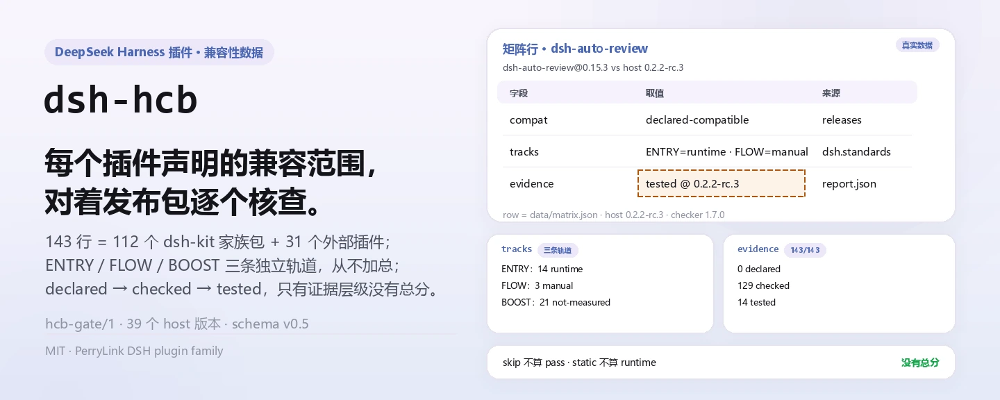
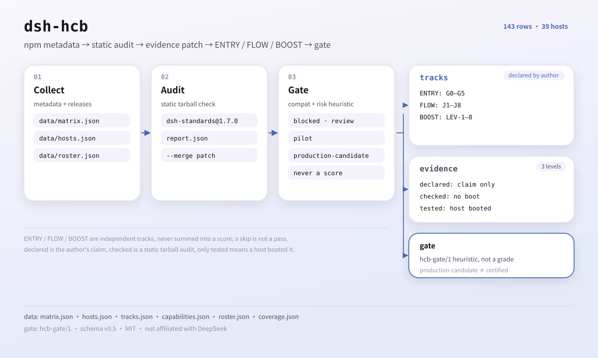
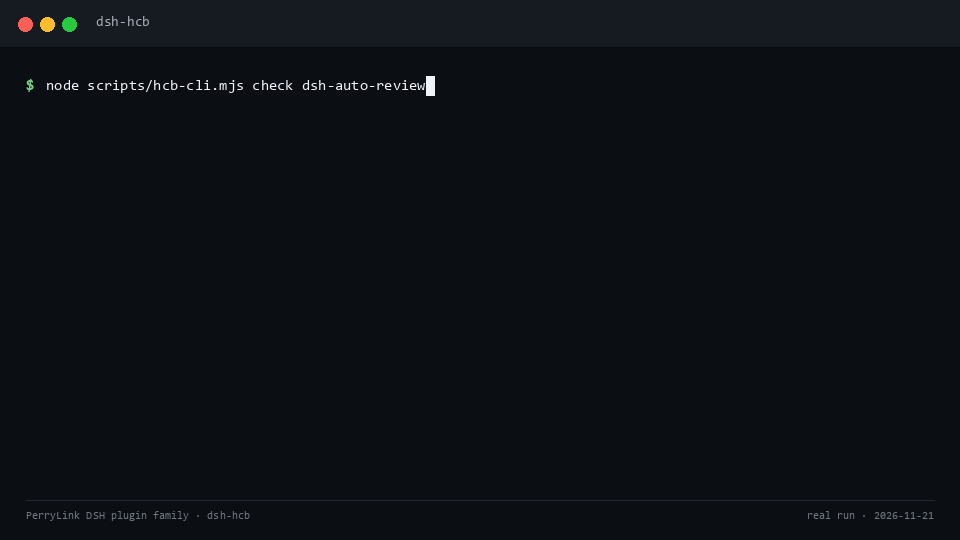

<div align="center">

<picture>
  <source media="(prefers-color-scheme: dark)" srcset="docs/assets/dsh-hcb-hero-zh-dark.webp">
  
</picture>

# HCB —— DeepSeek Harness 插件的宿主兼容基线

**声明的兼容性 + 声明的采用轨道，外加一层明确的 `declared / checked / tested` 证据。**

*不是评分，不是认证，也不是运行时保证。独立社区项目 —— 与 DeepSeek 无关。*

[English](README.md) · [Español](README-es.md) · [Português](README-pt.md) · [हिन्दी](README-hi.md)

[](https://github.com/PerryLink/dsh-hcb/actions/workflows/self-check.yml)
[](https://www.npmjs.com/package/dsh-hcb)
[](LICENSE)

</div>

> **HCB 是 [dsh-standards](https://github.com/PerryLink/dsh-standards) 的数据/闸门子项目。**
> 规则、检查器以及 ENTRY/FLOW/BOOST 定义都在 dsh-standards。本仓库负责兼容性矩阵、轨道数据、v0.5 证据层、风险与 `hcb-gate/1`。
> 独立社区项目。**与 DeepSeek 无关。**

**官方入口：** [GitHub（主仓）](https://github.com/PerryLink/dsh-hcb) · [npm](https://www.npmjs.com/package/dsh-hcb) · [Gitee 镜像](https://gitee.com/perrylink/dsh-hcb) · [GitCode 镜像](https://gitcode.com/PerryLink/dsh-hcb)

```bash
npx dsh-hcb check dsh-auto-review
```

DSH 迭代很快，兼容性也经常被打断。插件作者与企业采购方没有一个统一的地方来回答：

- 这个插件*声明*支持哪些 DSH 版本？
- 它是否声明了 **DSH-ENTRY / DSH-FLOW / DSH-BOOST** 状态 —— 又带着什么证据？
- 有没有人独立**核查**过已发布的 tarball，还是这一行仍然只是声明？
- 它申请了哪些能力面？
- 它是可以试点了，还是需要先复核？

HCB 从包元数据（`engines.dsh`、`peerDependencies`、`dsh.capabilities`、`dsh.standards`）、DSH GitHub release，以及（对已审计的行）存档的检查器报告来回答这些问题。

---

<picture>
  <source media="(prefers-color-scheme: dark)" srcset="docs/assets/dsh-hcb-flow-v5-dark.svg">
  
</picture>

*结构：采集 → 审计 → 闸门；`data/matrix.json` 是唯一来源，`row.evidence.checker` 标注每一次审计，declared/checked/tested 是三级证据 —— skip 不算 pass，static 不算 runtime。图内只有真实的文件、脚本与轨道名，五语共用同一张结构图。*

## 三条轨道，不是三个等级

HCB 沿用 [dsh-standards](https://github.com/PerryLink/dsh-standards) 的模型。**ENTRY / FLOW / BOOST 是彼此独立的轨道；它们永远不会被加总成一个分数。**

| 轨道 | 问题 | 闸门 | 证据状态 |
|---|---|---|---|
| **DSH-ENTRY** | 能否被识别、安装、启动？ | G0–G5 | runtime / recognized / static / blocked / failed / not-run / stale |
| **DSH-FLOW** | 用户能否安装、配置、使用、恢复、卸载？ | J1–J8 | runtime / manual / not-run / failed / stale |
| **DSH-BOOST** | 是否原生且高效地使用 Cordis？ | LEV-1–8 | measured / not-measured / failed / stale |

规则：**跳过不是通过**；`static` 不是 `runtime`；**BOOST 不是闸门**；兼容性是包作者的声明，不是测试结果。见 [docs/TRACKS.md](docs/TRACKS.md)。

## v0.14.0（schema v0.5）里有什么

| 文件 | 含义 |
|---|---|
| `data/hosts.json` | DSH 发布版本（tag → version → date） |
| `data/matrix.json` | 插件 × host 兼容性**加上** `standards` 轨道、`evidence`、`risk` 与 `gate` |
| `data/tracks.json` | 各 ENTRY/FLOW/BOOST 状态与 gate 判定的计数 |
| `data/capabilities.json` | 能力 / 风险聚合 |
| `spec/tracks.json` | HCB 对 `dsh-levels/1` 的消费方映射 |
| `schema/hcb.schema.json` | 数据格式的 JSON Schema（v0.5） |
| `data/roster.json` | 官方 dsh-kit 家族 roster（112）+ 外部插件 |
| `data/coverage.json` | 相对 roster 的覆盖率 |
| `scripts/coverage.mjs` | 可复现性检查 |
| `scripts/collect.mjs` | 可复现的采集器；同一版本保留已有 checked 证据 |
| `scripts/audit-entry.mjs` | **v0.5**：打包 + 静态 ENTRY 检查 -> 证据补丁（可选 `--merge`） |
| `scripts/migrate-v05.mjs` | 一次性的 v0.4 -> v0.5 矩阵迁移 |
| `scripts/validate.mjs` | 校验矩阵、证据、汇总与闸门 |
| `docs/EVIDENCE.md` | 证据契约与复跑指南 |
| `.github/actions/check` | 可直接引用的 CI 检查 |
| `index.html` | 静态查看器（GitHub Pages） |

**证据等级**：

| 等级 | 由谁产出 | 证明了什么 |
|---|---|---|
| `declared` | npm 元数据 / `package.json#dsh.standards` | 只有作者的声明 |
| `checked` | `scripts/audit-entry.mjs` -> `dsh-standards@1.7.0 --scope entry --entry-claim static`（默认 **1.7.0**；历史行由 `row.evidence.checker` 标注 —— v0.6–v0.8.2 各轮用的是 `1.6.10`，v0.8.2 中的 `dsh-permission-rules` 除外） | 已发布的 tarball 被静态检查过；**没有启动** |
| `tested` | 真实的 DSH 宿主启动（ENTRY G0–G3；未来的 harness） | 观测到了运行时行为 |

v0.5 交付的是 `declared` 与 `checked` 机制。`tested` 已定义，但不是由 `audit-entry.mjs` 产出的；那个脚本刻意只做静态检查。字段契约、失败 / blocked 语义以及精确的复跑命令见 [`docs/EVIDENCE.md`](docs/EVIDENCE.md)。

## 当前覆盖（2026-11-15，v0.14.0）

- **143 个插件** = 完整的 112 包 dsh-kit 家族（34 个主线默认 + 53 个主线可选 + 10 个仅目录 + 15 个领域）+ 31 个外部插件
- **123** 个声明了 `engines.dsh`；**20** 个是 `unknown`
- **21** 个声明了 `dsh.standards`；**122** 个是 `not-declared`
- ENTRY：**14 个 `runtime` + 127 个 `recognized` + 2 个 `failed`**（129 checked + 14 tested），0 个 `not-run`，0 个 `unknown` —— runtime 行：guide、budget、defend、mask、memento、observe、test-drive、checkpoint-rewind、claude-move、data-quality、doublecheck、session-sync、auto-review、permission-rules（均为 G0–G3，host 0.2.2-rc.3）
- FLOW：**3 个 `manual` + 18 个 `not-run` + 122 个 `unknown`** —— `manual` 不是 `runtime`；没有任何插件给出运行时 FLOW 声明
- 证据：**0 个 `declared`、129 个 `checked`、14 个 `tested`**。14 个 tested 行在 host 0.2.2-rc.3 上通过了真实的 G0–G3 启动；其余是静态 `checked`。
- 检查器：**143/143 行都在 `dsh-standards@1.7.0` 上**（0 行仍停留在 `1.6.10`）。v0.10.2 重审了仍带 `1.6.10` 的 95 行；v0.10.3 重审了四个升级行；v0.11.1 重审了 12 个 release 刷新。ENTRY 现为**14 个 `runtime` + 127 个 `recognized` + 2 个 `failed`**，且每一行都由 `row.evidence.checker` 标注。
- 风险：13 high、66 medium、64 unknown（此前是 3 / 63 / 77 —— 刷新的行现在声明了能力）
- 闸门：2 个 `blocked`（`dsh-checkers` 与 `dsh-session-fork`，两者 ENTRY 都是 `failed`）、31 个 `review`、108 个 `pilot`、**2 个 `production-candidate`**（`dsh-auto-review` 与 `dsh-plugin-guide`：ENTRY runtime + FLOW manual + 风险 medium）。刷新的高能力行中有九个从 `pilot` 移到 `review`。

> 近乎为零的 `dsh.standards` 采用率本身就是一项发现。闸门是一个**兼容性/风险启发式**，不是质量评级。

## 相对官方 roster 的覆盖（2026-11-15）

HCB 以官方 `dsh-kit` 家族 roster（112 个包）为基准来衡量，而不是临时凑的名单：

| 分组 | 总数 | HCB 已覆盖 | 已 checked | 缺失 | 声明轨道 | 兼容性已声明 |
|---|---:|---:|---:|---:|---:|---:|
| mainline-default | 34 | 34 | 34 | 0 | 21 | 34 |
| mainline-opt-in | 53 | 53 | 53 | 0 | 0 | 53 |
| catalog-only | 10 | 10 | 10 | 0 | 0 | 10 |
| domain | 15 | 15 | 15 | 0 | 0 | 15 |
| external | 31 | 31 | 31 | 0 | 0 | 11 |

**112 / 112 个家族包（100%）都已覆盖并 `checked`**，**全部 31 个外部插件**同样如此。覆盖是完整的，但**证据深度不是**：只有 21 个插件声明了轨道，14 个有 ENTRY runtime。v0.6.0 为整个 mainline-default 集合加上静态 `checked` 流水线（34/34）；v0.7.0 开始 mainline-opt-in（19/53）；v0.8.0 完成全部 53 个 opt-in 行并加入最初 2 个 catalog-only 行（整体 96 checked）；v0.8.2 刷新三个变更的包版本，`checked` 保持 96，并用 16-ID 的检查器 1.7.0 重审 `dsh-permission-rules`（恢复 `recognized`）。v0.9.0 用 `dsh-standards@1.7.0` 审计完最后 8 个 catalog-only 与全部 15 个 domain 行（新增 23 个；96 -> 119 checked），家族封闭在 112/112 `checked`。**v0.10.0 用 `dsh-standards@1.7.0` 审计最后 24 个 `declared` 外部行（119 -> 143 checked）：23 个 `recognized`、1 个 `failed`（`dsh-session-fork@0.4.0`，已发布 tarball 缺少其声明的 `lib/index.js`）。** v0.10.2 用 `dsh-standards@1.7.0` 重审仍标 `1.6.10` 的 95 行（0 个 ENTRY/gate 变动；143 行现在全部记录 1.7.0），1.7.0 成为默认检查器。**v0.10.3 吸收了四个新版本 —— `dsh-lsp-actions@0.5.21`、`dsh-doublecheck@0.9.32`、`dsh-memento@0.5.31`、`dsh-session-sync@0.3.2` —— 四者都用 `1.7.0` 重审（全部 `recognized`，13/14 项检查，0 阻塞），并记录它们新的 `dsh.standards` 声明（声明轨道 5 -> 9；闸门分布不变）。** **v0.11.1 吸收 12 个新版本 —— `dsh-research-report@0.4.2`、`dsh-local-ai@0.2.27`、`dsh-industry-research@0.3.26`、`dsh-checkpoint-rewind@0.6.35`、`dsh-defend@0.3.28`、`dsh-claude-move@0.4.20`、`dsh-budget@0.4.26`、`dsh-data-quality@0.3.27`、`dsh-mask@0.2.25`、`dsh-fund-research@0.5.4`、`dsh-observe@0.2.28`、`dsh-test-drive@0.3.26` —— 十二者都用 `1.7.0` 重审（全部 `recognized`，13/14 项检查，0 阻塞），记录 52 条新能力与 12 个新的 `dsh.standards` 声明（声明轨道 9 -> 21）。** 剩下的工作是运行时 `tested` 矩阵，而不是更多静态覆盖。

运行 `npm run coverage` 可复现；以矩阵推导出的输出为准（已提交的 `data/coverage.json` 是历史快照）。

## CLI



*动图是仓库自带脚本对着已提交矩阵的真实输出（先 `node scripts/hcb-cli.mjs check dsh-auto-review`，再 `node scripts/coverage.mjs`；2026-11-21 复跑，不联网）。所有数字都由脚本从 `data/matrix.json` 读出，不是手写进 README 的。*

```bash
node scripts/hcb-cli.mjs check dsh-auto-review
node scripts/badge.mjs dsh-auto-review > badge.svg

# v0.5 证据审计（默认 dry run）
node scripts/audit-entry.mjs dsh-plugin-guide
node scripts/audit-entry.mjs dsh-plugin-guide --merge   # 先审补丁
npm run validate
npm test
```

## 快速开始

```bash
npm install
npm run collect   # 提高速率上限需要 GITHUB_TOKEN
npm run validate
python3 -m http.server 8080   # 打开 index.html
```

## 在 CI 里使用

```yaml
- uses: PerryLink/dsh-hcb/.github/actions/check@main
  with:
    package: your-npm-package
```

它会打印兼容性 + 轨道 + 闸门；默认只在 `declared-incompatible` 时失败。见 [docs/CI.md](docs/CI.md)。

## 如何加入一个插件

1. 把 npm 包名加进 `data/plugins.seed.json`。
2. 运行 `npm run collect`。
3. 可选但推荐：运行 `node scripts/audit-entry.mjs <package>`，审阅补丁后再 `--merge`；把原始报告提交到 `evidence/` 下。
4. 提 PR，带上重新生成的 `data/*.json`、证据报告/补丁，以及理由。checked 行必须包含它的 `reportPath`。

## 这不是什么

- 不是安全审计。声明的能力 ≠ 实际行为。
- 不是运行时测试。`checked` 是静态 tarball 检查；只有 `tested` 才意味着有宿主启动过它。
- 不是排名。没有总分；ENTRY/FLOW/BOOST 彼此分开。
- 不是认证。`production-candidate` 只表示 HCB 在它所知道的检查里没发现阻塞。
- 不是官方。不要用 DeepSeek 的名字/标志暗示背书。

## 路线图

- **v0.4** 覆盖全家 112 个包 + 三条轨道 + 风险/闸门。
- **v0.5** 证据层：`declared` / `checked` / `tested`、静态审计流水线、补丁。
- **v0.6** 完成 mainline-default 的静态 `checked` 覆盖（34/34；整体 41 checked）；运行时 `tested` 矩阵、能力差异与 stale 告警仍是后续工作。
- **v0.7** mainline-opt-in 53 行中的前 19 行静态 `checked`（整体 60 checked）。
- **v0.8** 完成 mainline-opt-in（53/53），并加入 10 个 catalog-only 行中的前 2 行静态 `checked`（整体 96 checked）；剩余 8 个 catalog-only、15 个 domain、24 个 external 行以及运行时 `tested` 仍是后续工作。
- **v0.8.1** 从 npm 刷新 `dsh-auto-review@0.15.2`、`dsh-permission-rules@0.8.1` 与 `dsh-plugin-guide@0.5.9`；三者重审（`checked` 保持 96）；在 16-ID 检查器能校验 `sessions:write` 之前，`dsh-permission-rules` 的 ENTRY 保持 `blocked`；为 auto-review 与 permission-rules 记录 FLOW `manual`（绝不是 `runtime`）。
- **v0.9** 收尾家族：剩余 8 个 catalog-only + 15 个 domain 行用 `dsh-standards@1.7.0` 静态 `checked`（新增 23；整体 119 checked；112/112 家族 `checked`）；24 个外部行仍为 `declared`，运行时 `tested` 仍是后续工作。
- **v0.10** 收尾矩阵：剩余 24 个外部行全部用 `dsh-standards@1.7.0` 静态 `checked`（119 -> 143 checked；**0 个 `declared`**），23 个 `recognized` + 1 个 `failed`（`dsh-session-fork@0.4.0`，缺少构建产物入口）。没有 `tested` 证据；运行时 `tested`、能力差异与 stale 告警仍是后续工作。
- **v0.10.2** 统一检查器：用 `1.7.0` 重审仍停留在 `dsh-standards@1.6.10` 的 95 行（143/143 现在都是 1.7.0；ENTRY 仍是 141 `recognized` + 2 `failed`），把 1.7.0 设为默认，并用 `row.evidence.checker` 标注历史行。
- **v0.10.3** 吸收 `dsh-lsp-actions@0.5.21`、`dsh-doublecheck@0.9.32`、`dsh-memento@0.5.31` 与 `dsh-session-sync@0.3.2`：四次 `1.7.0` 重审，全部 `recognized`（13/14，0 阻塞）；声明轨道 5 -> 9；ENTRY/gate 不变（141 `recognized` + 2 `failed`；2 blocked / 21 review / 120 pilot）。
- **v0.11.1** 吸收 12 个新版本（`dsh-research-report@0.4.2` 到 `dsh-test-drive@0.3.26`）：12 次 `1.7.0` 重审，全部 `recognized`（13/14，0 阻塞），52 条能力，声明轨道 9 -> 21；九个高能力行从 `pilot` 移到 `review`，因此闸门是 2 blocked / 30 review / 110 pilot / 1 production-candidate。`dsh-mcp-panel`（0.6.32 未发布）与 `dsh-click`（0.3.29；0.3.30 在定范围时尚未发布）保持旧版本。
- **v1.0** 稳定 schema + CI action + 每周刷新 + DOI。

## 许可

MIT（代码与数据）。见 `LICENSE`。轨道模型来自 dsh-standards，为 Apache-2.0；见 `NOTICE.md`。
