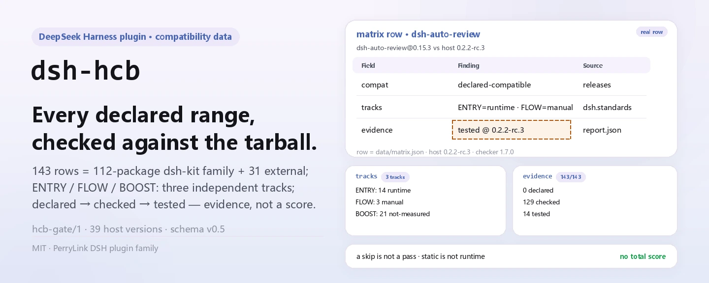
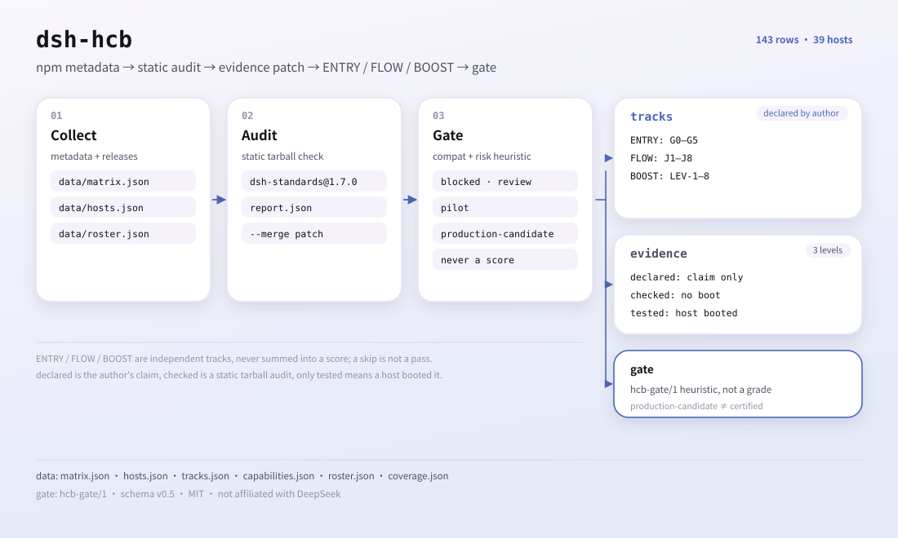
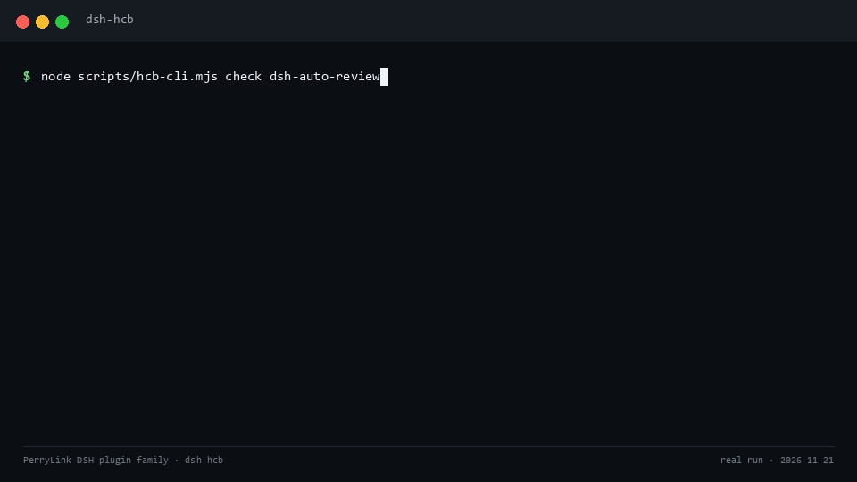

<div align="center">

<picture>
  <source media="(prefers-color-scheme: dark)" srcset="docs/assets/dsh-hcb-hero-en-dark.webp">
  
</picture>

# HCB — Host Compatibility Baseline for DeepSeek Harness plugins

**Declared compatibility + declared adoption tracks, with an explicit `declared / checked / tested` evidence layer.**

*Not a score, not a certification, and not a runtime guarantee. Independent community project — not affiliated with DeepSeek.*

[简体中文](README-zh.md) · [Español](README-es.md) · [Português](README-pt.md) · [हिन्दी](README-hi.md)

[](https://github.com/PerryLink/dsh-hcb/actions/workflows/self-check.yml)
[](https://www.npmjs.com/package/dsh-hcb)
[](LICENSE)

</div>

> **HCB is the data/gate subproject of [dsh-standards](https://github.com/PerryLink/dsh-standards).**
> Rules, checker and ENTRY/FLOW/BOOST definitions live in dsh-standards. This repo holds the compatibility matrix, tracks data, the v0.5 evidence layer, risk and `hcb-gate/1`.
> Independent community project. **Not affiliated with DeepSeek.**

**Official:** [GitHub (canonical)](https://github.com/PerryLink/dsh-hcb) · [npm](https://www.npmjs.com/package/dsh-hcb) · [Gitee mirror](https://gitee.com/perrylink/dsh-hcb) · [GitCode mirror](https://gitcode.com/PerryLink/dsh-hcb)

```bash
npx dsh-hcb check dsh-auto-review
```

DSH ships fast and breaks compatibility often. Plugin authors and enterprise buyers have no single place to answer:

- Which DSH versions does this plugin *declare* support?
- Does it declare **DSH-ENTRY / DSH-FLOW / DSH-BOOST** status — and with what evidence?
- Has anybody independently **checked** the published tarball, or is the row still only a claim?
- What capability surface does it request?
- Is it ready to pilot, or does it need review first?

HCB answers these from package metadata (`engines.dsh`, `peerDependencies`, `dsh.capabilities`, `dsh.standards`), DSH GitHub releases, and — for rows that have been audited — a stored checker report.

---

## Three tracks, not three levels

HCB follows the [dsh-standards](https://github.com/PerryLink/dsh-standards) model. **ENTRY / FLOW / BOOST are independent tracks; they are never summed into a score.**

| Track | Question | Gates | Evidence states |
|---|---|---|---|
| **DSH-ENTRY** | can it be recognized, installed, booted? | G0–G5 | runtime / recognized / static / blocked / failed / not-run / stale |
| **DSH-FLOW** | can a user install, configure, use, recover, uninstall? | J1–J8 | runtime / manual / not-run / failed / stale |
| **DSH-BOOST** | does it use Cordis natively and efficiently? | LEV-1–8 | measured / not-measured / failed / stale |

Rules: **a skip is not a pass**; `static` is not `runtime`; **BOOST is not a gate**; compatibility is a claim by the package author, not a test result. See [docs/TRACKS.md](docs/TRACKS.md).


<picture>
  <source media="(prefers-color-scheme: dark)" srcset="docs/assets/dsh-hcb-flow-v5-dark.svg">
  
</picture>

*Structure: collect → audit → gate; `data/matrix.json` is the source, `row.evidence.checker` labels every audit, and declared/checked/tested are the three evidence levels — a skip is not a pass and static is not runtime. The token labels inside the diagram are the real file, script and track names, so the same picture serves all five languages.*

## What is in v0.14.0 (schema v0.5)

| File | Meaning |
|---|---|
| `data/hosts.json` | DSH releases (tag → version → date) |
| `data/matrix.json` | plugin × host compatibility **plus** `standards` tracks, `evidence`, `risk`, and `gate` |
| `data/tracks.json` | counts per ENTRY/FLOW/BOOST state and gate decision |
| `data/capabilities.json` | capability / risk aggregation |
| `spec/tracks.json` | HCB's consumer mapping of `dsh-levels/1` |
| `schema/hcb.schema.json` | JSON Schema (v0.5) for the data format |
| `data/roster.json` | canonical dsh-kit family roster (112) + external |
| `data/coverage.json` | coverage vs roster |
| `scripts/coverage.mjs` | reproducibility check |
| `scripts/collect.mjs` | reproducible collector; preserves checked evidence for the same version |
| `scripts/audit-entry.mjs` | **v0.5**: pack + static ENTRY check -> evidence patch (optional `--merge`) |
| `scripts/migrate-v05.mjs` | one-shot v0.4 -> v0.5 matrix migration |
| `scripts/validate.mjs` | validates the matrix, evidence, summary and gate |
| `docs/EVIDENCE.md` | evidence contract and re-run guide |
| `.github/actions/check` | drop-in CI check |
| `index.html` | static viewer (GitHub Pages) |

**Evidence levels**:

| Level | Produced by | Proves |
|---|---|---|
| `declared` | npm metadata / `package.json#dsh.standards` | the author's claim only |
| `checked` | `scripts/audit-entry.mjs` -> `dsh-standards@1.7.0 --scope entry --entry-claim static` (default **1.7.0**; historical rows are labeled by `row.evidence.checker` — v0.6–v0.8.2 rounds used `1.6.10`, except `dsh-permission-rules` in v0.8.2) | the published tarball was statically examined; **no boot** |
| `tested` | a real DSH host boot (ENTRY G0–G3; future harness) | runtime behaviour was observed |

v0.5 ships the `declared` and `checked` machinery. `tested` is defined but is
not produced by `audit-entry.mjs`; the script is intentionally static-only.
See [`docs/EVIDENCE.md`](docs/EVIDENCE.md) for the field contract, failure /
blocked semantics, and the exact re-run commands.

## Current coverage (2026-11-15, v0.14.0)

- **143 plugins** = the full 112-package dsh-kit family (34 mainline-default + 53 opt-in + 10 catalog-only + 15 domain) + 31 external
- **123** declare `engines.dsh`; **20** are `unknown`
- **21** declare `dsh.standards`; **122** are `not-declared`
- ENTRY: **14 `runtime` + 127 `recognized` + 2 `failed`** (129 checked + 14 tested), 0 `not-run`, 0 `unknown` — runtime rows: guide, budget, defend, mask, memento, observe, test-drive, checkpoint-rewind, claude-move, data-quality, doublecheck, session-sync, auto-review, permission-rules (all G0–G3, host 0.2.2-rc.3)
- FLOW: **3 `manual` + 18 `not-run` + 122 `unknown`** — `manual` is not `runtime`; no plugin has a runtime FLOW claim
- Evidence: **0 `declared`, 129 `checked`, 14 `tested`**. The 14 tested rows passed a real G0–G3 boot on host 0.2.2-rc.3; the rest are static `checked`.
- Checker: **143/143 rows on `dsh-standards@1.7.0`** (0 rows still on `1.6.10`). v0.10.2 re-audited the 95 rows that still carried `1.6.10`; v0.10.3 re-audited the four bumped rows; v0.11.1 re-audited the 12 release refreshes. ENTRY now reads **14 `runtime` + 127 `recognized` + 2 `failed`** and every row is labeled by `row.evidence.checker`.
- Risk: 13 high, 66 medium, 64 unknown (up from 3 / 63 / 77 — the refreshed rows now declare capabilities)
- Gate: 2 `blocked` (`dsh-checkers` and `dsh-session-fork`, both `failed` ENTRY), 31 `review`, 108 `pilot`, **2 `production-candidate`** (`dsh-auto-review` and `dsh-plugin-guide`: ENTRY runtime + FLOW manual + risk medium). Nine of the refreshed high-capability rows moved `pilot` -> `review`.

> The near-zero `dsh.standards` adoption is itself a finding. The gate is a **compatibility/risk heuristic**, not a quality grade.


## Coverage vs canonical roster (2026-11-15)

HCB is measured against the canonical `dsh-kit` family roster (112 packages), not an ad-hoc list:

| Group | Total | Covered by HCB | Checked | Missing | Declared tracks | Compat declared |
|---|---:|---:|---:|---:|---:|---:|
| mainline-default | 34 | 34 | 34 | 0 | 21 | 34 |
| mainline-opt-in | 53 | 53 | 53 | 0 | 0 | 53 |
| catalog-only | 10 | 10 | 10 | 0 | 0 | 10 |
| domain | 15 | 15 | 15 | 0 | 0 | 15 |
| external | 31 | 31 | 31 | 0 | 0 | 11 |

**112 / 112 family packages (100%) are covered and `checked`**, and so are **all 31 external plugins**. Coverage is complete, but **evidence depth is not**: only 21 plugins declare tracks, and 14 have ENTRY runtime. v0.6.0 added the static `checked` pipeline for the whole mainline-default set (34/34); v0.7.0 started mainline-opt-in (19/53); v0.8.0 finishes all 53 opt-in rows and adds the first 2 catalog-only rows (96 checked overall); v0.8.2 refreshes three changed package versions, keeps `checked` at 96, and re-audits `dsh-permission-rules` with the 16-ID checker 1.7.0 (restoring `recognized`). v0.9.0 audits the last 8 catalog-only and all 15 domain rows with `dsh-standards@1.7.0` (23 new; 96 -> 119 checked) and closes the family at 112/112 `checked`. **v0.10.0 audits the last 24 external `declared` rows with `dsh-standards@1.7.0` (119 -> 143 checked): 23 `recognized`, 1 `failed` (`dsh-session-fork@0.4.0`, published tarball missing its declared `lib/index.js`).** **v0.10.2 re-audits the 95 rows still labeled `1.6.10` with `dsh-standards@1.7.0` (0 ENTRY/gate moves; all 143 rows now record 1.7.0), and 1.7.0 becomes the default checker.** **v0.10.3 absorbs four new releases — `dsh-lsp-actions@0.5.21`, `dsh-doublecheck@0.9.32`, `dsh-memento@0.5.31`, `dsh-session-sync@0.3.2` — re-audits all four with `1.7.0` (all `recognized`, 13/14 checks, 0 blocking) and records their new `dsh.standards` declarations (declared tracks 5 -> 9; gate split unchanged).** **v0.11.1 absorbs 12 new releases — `dsh-research-report@0.4.2`, `dsh-local-ai@0.2.27`, `dsh-industry-research@0.3.26`, `dsh-checkpoint-rewind@0.6.35`, `dsh-defend@0.3.28`, `dsh-claude-move@0.4.20`, `dsh-budget@0.4.26`, `dsh-data-quality@0.3.27`, `dsh-mask@0.2.25`, `dsh-fund-research@0.5.4`, `dsh-observe@0.2.28`, `dsh-test-drive@0.3.26` — re-audits all 12 with `1.7.0` (all `recognized`, 13/14 checks, 0 blocking), records 52 new capability entries and 12 new `dsh.standards` declarations (declared tracks 9 -> 21).** The remaining work is a runtime `tested` matrix, not more static coverage.

Run `npm run coverage` to reproduce; the matrix-derived output is authoritative (the committed `data/coverage.json` is a historical snapshot).

## CLI



*Animated: the checked-in scripts' real output over the committed matrix (`node scripts/hcb-cli.mjs check dsh-auto-review`, then `node scripts/coverage.mjs`; re-run 2026-11-21, no network). Every number is read from `data/matrix.json` by the scripts, not typed into the README.*

```bash
node scripts/hcb-cli.mjs check dsh-auto-review
node scripts/badge.mjs dsh-auto-review > badge.svg

# v0.5 evidence audit (dry run by default)
node scripts/audit-entry.mjs dsh-plugin-guide
node scripts/audit-entry.mjs dsh-plugin-guide --merge   # review the patch first
npm run validate
npm test
```

## Quick start

```bash
npm install
npm run collect   # needs GITHUB_TOKEN for higher rate limits
npm run validate
python3 -m http.server 8080   # open index.html
```

## Use in CI

```yaml
- uses: PerryLink/dsh-hcb/.github/actions/check@main
  with:
    package: your-npm-package
```

It prints compatibility + tracks + gate; fails only on `declared-incompatible` by default. See [docs/CI.md](docs/CI.md).

## How to add a plugin

1. Add the npm package name to `data/plugins.seed.json`.
2. Run `npm run collect`.
3. Optional but encouraged: run `node scripts/audit-entry.mjs <package>` and,
   after reviewing the patch, `--merge`; commit the raw report under `evidence/`.
4. Open a PR with the regenerated `data/*.json`, the evidence report/patch, and
   the reason. A checked row must include its `reportPath`.

## What this is not

- Not a security audit. Declared capabilities ≠ actual behavior.
- Not a runtime test. `checked` is a static tarball check; only `tested` means a host booted it.
- Not a ranking. No total score; ENTRY/FLOW/BOOST are separate.
- Not a certification. `production-candidate` only means HCB found no blocker in the checks it knows.
- Not official. Do not use the DeepSeek name/logo to imply endorsement.

## Roadmap

- **v0.4** full 112-package family coverage + three tracks + risk/gate.
- **v0.5** evidence layer: `declared` / `checked` / `tested`, static audit pipeline, patches.
- **v0.6** full mainline-default static `checked` coverage (34/34; 41 checked overall); runtime `tested` matrix, capability diff and stale alerts remain future work.
- **v0.7** first 19 of 53 mainline-opt-in rows statically `checked` (60 checked overall).
- **v0.8** finish mainline-opt-in (53/53) and add the first 2 of 10 catalog-only rows statically `checked` (96 checked overall); the remaining 8 catalog-only, 15 domain and 24 external rows plus runtime `tested` remain future work.
- **v0.8.1** refresh `dsh-auto-review@0.15.2`, `dsh-permission-rules@0.8.1` and `dsh-plugin-guide@0.5.9` from npm; re-audit all three (`checked` stays 96); hold `dsh-permission-rules` ENTRY `blocked` until a 16-ID checker can validate `sessions:write`; record FLOW `manual` for auto-review and permission-rules (never `runtime`).
- **v0.9** finish the family: 8 remaining catalog-only + 15 domain rows statically `checked` with `dsh-standards@1.7.0` (23 new; 119 checked overall; 112/112 family `checked`); 24 external rows stay `declared`, runtime `tested` remains future work.
- **v0.10** finish the matrix: all 24 remaining external rows statically `checked` with `dsh-standards@1.7.0` (119 -> 143 checked; **0 `declared`**), 23 `recognized` + 1 `failed` (`dsh-session-fork@0.4.0`, missing built entry). No `tested` evidence; runtime `tested`, capability diff and stale alerts remain future work.
- **v0.10.2** unify the checker: re-audit the 95 rows still on `dsh-standards@1.6.10` with `1.7.0` (143/143 now 1.7.0; ENTRY stays 141 `recognized` + 2 `failed`), make 1.7.0 the default, and label historical rows by `row.evidence.checker`.
- **v0.10.3** absorb `dsh-lsp-actions@0.5.21`, `dsh-doublecheck@0.9.32`, `dsh-memento@0.5.31` and `dsh-session-sync@0.3.2`: four `1.7.0` re-audits, all `recognized` (13/14, 0 blocking); declared tracks 5 -> 9; ENTRY/gate unchanged (141 `recognized` + 2 `failed`; 2 blocked / 21 review / 120 pilot).
- **v0.11.1** absorb 12 new releases (`dsh-research-report@0.4.2` through `dsh-test-drive@0.3.26`): 12 `1.7.0` re-audits, all `recognized` (13/14, 0 blocking), 52 capability entries, declared tracks 9 -> 21; nine high-capability rows move `pilot` -> `review`, so gate is 2 blocked / 30 review / 110 pilot / 1 production-candidate. `dsh-mcp-panel` (0.6.32 not published) and `dsh-click` (0.3.29; 0.3.30 was staged at scope time) stay at their old versions.
- **v1.0** stable schema + CI action + weekly refresh + DOI.

## License

MIT (code and data). See `LICENSE`. The track model is Apache-2.0 from dsh-standards; see `NOTICE.md`.
